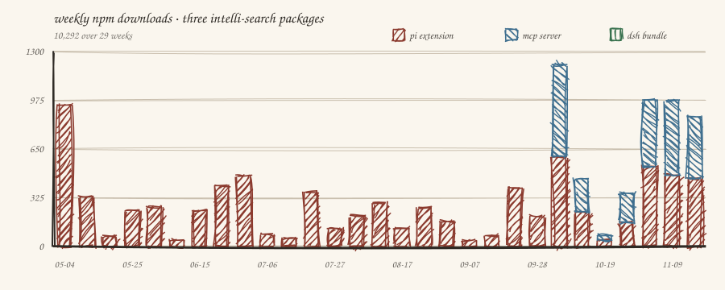

<!-- Generated from the repository README.md by scripts/generate-package-readmes.mjs. Edit the root README.md, then run npm run generate:readmes and npm run generate:plugins. -->

# Intelli Search for DeepSeek Harness

[](https://www.npmjs.com/package/@curio-data/dsh-intelli-search)
[](https://www.npmjs.com/package/@curio-data/dsh-intelli-search)
[](https://github.com/Curio-Data/pi-intelli-search/blob/main/LICENSE)


Intelligent web research for coding agents: search, extract, collate, and cache grounded web context in one tool call.

<p align="center">
  
</p>

**Features:**

- 🔍 **Search:** a search-grounded model, [_Perplexity Sonar_](https://docs.perplexity.ai) via [_OpenRouter_](https://openrouter.ai) by default. One application programming interface (API) key, no $50 minimum. Chat models with tool support also work through the web search server tool; see [native search settings](https://github.com/Curio-Data/pi-intelli-search/blob/mcp-v0.25.1/README.md#openrouter-web-search-server-tool) or [Model Context Protocol (MCP) tuning](https://github.com/Curio-Data/pi-intelli-search/blob/mcp-v0.25.1/README.md#tuning).
- 🔗 **Harvest:** provider-supplied citation links recovered from the response, alongside links in the answer. Recognised `url_citation` annotations are merged with text links before pages are selected; recovery is best-effort, not a complete record of sources consulted.
- 🌐 **Fetch:** Dual-fetch each page (Hypertext Markup Language (HTML) → [_Defuddle_](https://github.com/kepano/defuddle) versus Markdown endpoint), compare quality, pick the cleaner version.
- 📄 **Extract:** Per-page large language model (LLM) extraction guided by a _focused prompt_. Compresses ≈50K to ≈3-5K chars of query-relevant content.
- 🔗 **Collate:** Cross-source deduplication, inconsistency detection, and synthesis into a focused ≈5K-character summary.
- 📚 **Batch Research:** One `intelli_research` call accepts two or more questions known at launch (up to ten by default) and returns either a separate answer for each (independent mode) or one merged report on a common topic (expansion mode). The entries run concurrently, four at a time by default, and the agent receives every answer in one result instead of making one call per question. In one paired benchmark on the native `Pi` host, a session that submitted five questions on one topic as one expansion batch used ≈74% less main-model input and finished ≈63% sooner than a session making five separate calls. The main-model charge fell ≈25%, because most of the separate calls' input was cached context billed below the full input price. That is one pair on one topic, not a general result. Batching follows observed use: in a survey of one host's agent transcripts, 39% of `Pi` messages calling `intelli_research` issued two to five calls, and 15 of 30 sampled follow-up calls made within five minutes were steps the agent had already planned. See [Planned Research Questions](https://github.com/Curio-Data/pi-intelli-search/blob/mcp-v0.25.1/plugins/dsh/README.md#planned-research-questions), the [benchmark](https://github.com/Curio-Data/pi-intelli-search/blob/main/docs/BENCHMARKS.md#batch-research-on-the-native-host) and the [survey](https://github.com/Curio-Data/pi-intelli-search/blob/main/docs/proposals/BATCH-RESEARCH.md#evidence).
- 🧠 **Reasoning-Aware Output Budget:** When a reasoning model spends its output cap on hidden reasoning, research retries at a doubled cap (8,000, then 16,000, then 32,000 tokens by default) before reporting a failure. See [Output Budget Retry](https://github.com/Curio-Data/pi-intelli-search/blob/mcp-v0.25.1/plugins/dsh/README.md#output-budget-retry).
- 📏 **Long Pages, Bounded Collation:** Extraction reads up to 400,000 characters of each page. When the extractions exceed the [collation input budget](https://github.com/Curio-Data/pi-intelli-search/blob/mcp-v0.25.1/plugins/dsh/README.md#collation-input-budget), the longest are trimmed at clean boundaries, and the result gives the path of each trimmed extraction's full saved file.
- 🧾 **Recoverable Failures:** When no extraction succeeds, research saves the fetched pages and a failure report; when synthesis fails, it saves the pages and extractions as well. The result names the saved files, so the agent can read them rather than repeat the paid stages. See [Extraction Diagnostics](https://github.com/Curio-Data/pi-intelli-search/blob/mcp-v0.25.1/plugins/dsh/README.md#extraction-diagnostics).
- 📂 **Code and Text Sources:** Raw source files and text responses are saved and extracted alongside HTML pages. References named in search text without a link are fetched as labelled guesses; see [Inferred Assets](https://github.com/Curio-Data/pi-intelli-search/blob/mcp-v0.25.1/plugins/dsh/README.md#inferred-assets).
- 💾 **Cache:** Persistent `.search/` cache with automatic cache suggest. Related previous searches surfaced on each query.
- 🎯 **Configurable:** Select models independently for search, extract and collate. The native extension uses registered, authenticated `Pi` models (capability and context limits apply); the MCP server uses explicitly selected OpenRouter models.
- 💰 **Cost:** see the [default research-run estimate](https://github.com/Curio-Data/pi-intelli-search/blob/mcp-v0.25.1/plugins/dsh/README.md#cost).

`@curio-data/dsh-intelli-search` adds cited web search and multi-page research to a [_DeepSeek Harness_](https://github.com/deepseek-ai/deepseek-harness) (`dsh`) profile. It is a configuration bundle, not an extension. One bridge row starts the standalone Model Context Protocol (MCP) server [`@curio-data/mcp-intelli-search`](https://www.npmjs.com/package/@curio-data/mcp-intelli-search), version `0.25.1`, through `npx` with `--host dsh`; one registrar registers the `intelli-search` skill with the harness. Search, page fetching, extraction and collation run in that server, which saves each research report with its sources in the project's `.search/` directory. Inference uses an [_OpenRouter_](https://openrouter.ai) account; [_Node.js_](https://nodejs.org/) runs the server.

The harness names the server `intelli`, so the four tools appear as:

| Tool | Use |
|---|---|
| `mcp__intelli__intelli_search` | Quick search: one concise answer with numbered sources, for facts, current versions and release dates. No page fetching or extraction |
| `mcp__intelli__intelli_research` | Research: search, fetch up to `maxUrls` pages, extract each page, collate a cited report and cache it. Accepts a batch of questions known at launch, with `batchMode: "independent"` for a separate answer per question or `"expansion"` for one merged report |
| `mcp__intelli__intelli_extract` | Extract query-relevant content from one page |
| `mcp__intelli__intelli_collate` | Deduplicate and synthesise extractions into a cached report |

Start with a quick search; use research for comparisons, detailed analysis or a gap a search answer leaves. Each research call costs more and takes longer than a search.

## Contents

<!-- TOC:START -->

- [Prerequisites](https://github.com/Curio-Data/pi-intelli-search/blob/mcp-v0.25.1/plugins/dsh/README.md#prerequisites)
- [Installation](https://github.com/Curio-Data/pi-intelli-search/blob/mcp-v0.25.1/plugins/dsh/README.md#installation)
- [Upgrade, Restart and Removal](https://github.com/Curio-Data/pi-intelli-search/blob/mcp-v0.25.1/plugins/dsh/README.md#upgrade-restart-and-removal)
- [Credentials](https://github.com/Curio-Data/pi-intelli-search/blob/mcp-v0.25.1/plugins/dsh/README.md#credentials)
- [Workspace](https://github.com/Curio-Data/pi-intelli-search/blob/mcp-v0.25.1/plugins/dsh/README.md#workspace)
- [Configuration](https://github.com/Curio-Data/pi-intelli-search/blob/mcp-v0.25.1/plugins/dsh/README.md#configuration)
- [Verification](https://github.com/Curio-Data/pi-intelli-search/blob/mcp-v0.25.1/plugins/dsh/README.md#verification)
- [Timeouts](https://github.com/Curio-Data/pi-intelli-search/blob/mcp-v0.25.1/plugins/dsh/README.md#timeouts)
- [Troubleshooting](https://github.com/Curio-Data/pi-intelli-search/blob/mcp-v0.25.1/plugins/dsh/README.md#troubleshooting)
- [Charges, Cache and Privacy](https://github.com/Curio-Data/pi-intelli-search/blob/mcp-v0.25.1/plugins/dsh/README.md#charges-cache-and-privacy)
- [Evidence and Limits](https://github.com/Curio-Data/pi-intelli-search/blob/mcp-v0.25.1/plugins/dsh/README.md#evidence-and-limits)
- [Further Documentation](https://github.com/Curio-Data/pi-intelli-search/blob/mcp-v0.25.1/plugins/dsh/README.md#further-documentation)
- [Tools](https://github.com/Curio-Data/pi-intelli-search/blob/mcp-v0.25.1/plugins/dsh/README.md#tools)
  - [Evidence and Provenance](https://github.com/Curio-Data/pi-intelli-search/blob/mcp-v0.25.1/plugins/dsh/README.md#evidence-and-provenance)
  - [Inferred Assets](https://github.com/Curio-Data/pi-intelli-search/blob/mcp-v0.25.1/plugins/dsh/README.md#inferred-assets)
  - [Extraction Diagnostics](https://github.com/Curio-Data/pi-intelli-search/blob/mcp-v0.25.1/plugins/dsh/README.md#extraction-diagnostics)
    - [Output Budget Retry](https://github.com/Curio-Data/pi-intelli-search/blob/mcp-v0.25.1/plugins/dsh/README.md#output-budget-retry)
  - [Collation Input Budget](https://github.com/Curio-Data/pi-intelli-search/blob/mcp-v0.25.1/plugins/dsh/README.md#collation-input-budget)
- [Usage Examples](https://github.com/Curio-Data/pi-intelli-search/blob/mcp-v0.25.1/plugins/dsh/README.md#usage-examples)
  - [Quick Search](https://github.com/Curio-Data/pi-intelli-search/blob/mcp-v0.25.1/plugins/dsh/README.md#quick-search)
  - [Planned Research Questions](https://github.com/Curio-Data/pi-intelli-search/blob/mcp-v0.25.1/plugins/dsh/README.md#planned-research-questions)
  - [Deep Research](https://github.com/Curio-Data/pi-intelli-search/blob/mcp-v0.25.1/plugins/dsh/README.md#deep-research)
  - [Targeted Research With Domain Guidance](https://github.com/Curio-Data/pi-intelli-search/blob/mcp-v0.25.1/plugins/dsh/README.md#targeted-research-with-domain-guidance)
  - [Comparing Options](https://github.com/Curio-Data/pi-intelli-search/blob/mcp-v0.25.1/plugins/dsh/README.md#comparing-options)
- [Pipeline](https://github.com/Curio-Data/pi-intelli-search/blob/mcp-v0.25.1/plugins/dsh/README.md#pipeline)
- [Cost](https://github.com/Curio-Data/pi-intelli-search/blob/mcp-v0.25.1/plugins/dsh/README.md#cost)
- [Cache Structure](https://github.com/Curio-Data/pi-intelli-search/blob/mcp-v0.25.1/plugins/dsh/README.md#cache-structure)
- [Documentation](https://github.com/Curio-Data/pi-intelli-search/blob/mcp-v0.25.1/plugins/dsh/README.md#documentation)
- [Downloads](https://github.com/Curio-Data/pi-intelli-search/blob/mcp-v0.25.1/plugins/dsh/README.md#downloads)
- [Sponsor](https://github.com/Curio-Data/pi-intelli-search/blob/mcp-v0.25.1/plugins/dsh/README.md#sponsor)
- [Licence](https://github.com/Curio-Data/pi-intelli-search/blob/mcp-v0.25.1/plugins/dsh/README.md#licence)
- [Use of Large Language Models](https://github.com/Curio-Data/pi-intelli-search/blob/mcp-v0.25.1/plugins/dsh/README.md#use-of-large-language-models)

<!-- TOC:END -->

<a id="requirements"></a>
## Prerequisites

- `dsh` within the bundle's declared range, `>=0.2.2-rc.1 <0.3.0`. The range is a compatibility declaration; Evidence and Limits names the versions tested.
- Node.js 24.9 or later, the harness's own floor, with `node` and `npx` on `PATH`. The bridge row starts the server through `npx`.
- For the `dsh plugin` commands below, put `pnpm` on `PATH` unless the launcher supplies its own package manager. The `pnpmCommand` setting configures the in-harness plugin manager, not these commands.
- Network access on the first start, when `npx` downloads the MCP server package. Later starts reuse the `npx` cache.
- An OpenRouter API key on an account with credit. Every search and research call bills that account, separately from any harness subscription.
- Linux for verified operation. The server's native fetch assets are verified on Linux x86-64 only, and every recorded check of this bundle ran on Linux; _macOS_ and _Windows_ are not verified.

## Installation

The bundle installs into one harness profile, and only that profile loads it. Install it into the profile the harness is started with, the name given to `--profile`. The examples set `profile=web`, one of the profiles the harness ships; change that value to the profile in use. A misspelt profile name leaves the tools absent from the profile in use.

```bash
profile=web
dsh plugin --profile "$profile" add @curio-data/dsh-intelli-search
```

In the Web interface, the harness documents an equivalent route: open **Plugins**, select **Add plugin** and enter `@curio-data/dsh-intelli-search`, the text that follows `add` in the command. This project's checks use the command line only.

After installation, start the profile from the project directory, or restart it if it is running:

```bash
profile=web
dsh --profile "$profile"
```

<a id="removal"></a>
## Upgrade, Restart and Removal

Each bundle version launches one exact MCP server version, so the server changes only when the bundle is updated. For a bundle installed by name, the Web **Plugins** page documents **Versions** and **Update** controls; restart the profile after updating. That route follows the harness's documentation and has not been exercised in this project's checks. From the command line, remove the bundle and add it again, then restart the profile:

```bash
profile=web
dsh plugin --profile "$profile" remove @curio-data/dsh-intelli-search
dsh plugin --profile "$profile" add @curio-data/dsh-intelli-search
dsh --profile "$profile"
```

Removal and reinstallation are verified; an update between two published versions by either route is not. A row override that sets `cwd` (see Workspace) keeps launching the server version written in it until the override is edited.

Restart the profile from the project directory after installing, updating or removing the bundle, after changing a key in an environment layer and after editing a configuration file the server has already loaded. The harness composes bundle rows and reads environment files at launch, and the server keeps a loaded configuration for its lifetime.

To remove the bundle and confirm that both of its rows are gone from the composed profile:

```bash
profile=web
dsh plugin --profile "$profile" remove @curio-data/dsh-intelli-search
dsh --profile "$profile" --dump-config
```

The dump no longer lists the rows `mcp-intelli-search` and `intelli-search-skill`. Restart the profile to stop a server that is still running. Removal deletes no data: the per-user configuration and stored key under `${XDG_CONFIG_HOME:-$HOME/.config}/mcp-intelli-search/`, any `OPENROUTER_API_KEY` line in a `.env` file, each project's `.search/` cache and the `npx` cache remain until deleted separately. The per-user directory is shared with the Codex launcher. Delete any `mcp-intelli-search` override from the profile's `cordis.patch.yml` as well.

## Credentials

The server reads its OpenRouter key from the `OPENROUTER_API_KEY` environment variable or from a credential file. A nonempty environment value takes precedence over the file. Without either, the four tools still start and each call returns an actionable `CONFIGURATION` error. A key saved on the harness model-settings page does not reach this server: the harness resolves that credential through a service a child process cannot read.

**Environment Route.** The bridge row forwards `OPENROUTER_API_KEY` from the harness environment layer, which takes the first value it finds in the environment that launches the harness, then a `.env` file in the launch directory, then `$DSH_HOME/.env`. The harness reads these once at launch, so restart the profile after changing a key. The server treats an empty value as absent, so the row loads before a key is supplied. To keep the key in the harness-home file, create the file with user-only permissions before entering the key:

```bash
(umask 077; touch "${DSH_HOME:-$HOME/.dsh}/.env") && chmod 600 "${DSH_HOME:-$HOME/.dsh}/.env"
```

After the command succeeds, open the file in an editor, so the key stays out of shell history, and put `OPENROUTER_API_KEY=` followed by the key on its own line, replacing any earlier definition.

**Credential-File Route.** The server's `setup` command reads the key from standard input and stores it in a user-only file. It refuses a terminal as its input. Run the following block in _Bash_; if the current shell is not Bash, start `bash` first:

```bash
(
  set +x
  set +a
  unset key || exit 1
  IFS= read -r -s -p 'OpenRouter API key: ' key || exit 1
  printf '\n'
  printf '%s\n' "$key" | \
    npx -y --package @curio-data/mcp-intelli-search@0.25.1 \
    mcp-intelli-search setup
)
```

Paste and run the whole block. Wait for the `OpenRouter API key:` prompt before entering the key; input is hidden. The parentheses run the commands in a subshell with tracing and automatic export turned off. Setup receives the key on standard input, and the calling shell's variables remain unchanged. Confirm that setup prints `Setup complete.` followed by the configuration and credential paths. If that shell exports a nonempty `OPENROUTER_API_KEY`, setup also warns that the environment value takes precedence over the stored key.

Setup creates `${XDG_CONFIG_HOME:-$HOME/.config}/mcp-intelli-search/config.json` with the default models when it is absent, adds a missing `apiKeyFile` selection to an existing file and keeps existing model and tuning selections. It writes the key to `openrouter.key` beside that file. When the file already names a custom `apiKeyFile`, setup writes the key to that path and leaves the configuration file unchanged. Only an absolute `XDG_CONFIG_HOME` is honoured; an unset or relative value means `$HOME/.config`. Run setup with the same `XDG_CONFIG_HOME` as the harness, so both use one directory.

The server rereads the credential file on every call, so a new or replaced key takes effect on the next call without a restart. The file must be a regular file, owned by the current user, with no group or other access; setup creates it that way. To use the file while a key is also set in an environment layer, remove `OPENROUTER_API_KEY` from all three layers and restart the profile.

<a id="workspace-and-cache"></a>
## Workspace

The server uses the harness working directory as its workspace and writes the research cache, `.search/` by default, below it. Start the harness from the project directory: changing directory later in the session does not move the cache. A home or filesystem-root working directory is rejected, by each tool call with an actionable `WORKSPACE` error and by the configuration check, instead of creating one cache shared across projects. The four tools still appear.

For a fixed project root, override the row with id `mcp-intelli-search` in the profile's `cordis.patch.yml` under `$DSH_HOME/profiles/`, and set `cwd` to the absolute project path. Every session of that profile then caches in that directory, wherever the harness starts. The override replaces the row's entire `config`: copy its other `config` fields from the `--dump-config` output, keep the `OPENROUTER_API_KEY` expression exactly as shown there, and update the pinned server version after each bundle update. The home and filesystem-root rejection still applies to the `cwd` value.

## Configuration

With no per-user configuration file, the server uses built-in defaults: OpenRouter for every role, `perplexity/sonar` for search, `minimax/minimax-m3` for extraction and collation, and the shared tuning defaults, including a default budget of ten search-result pages per query (`defaultUrls`) and a cap of 20 per query (`maxUrls`). The defaults need no file.

The per-user file is `${XDG_CONFIG_HOME:-$HOME/.config}/mcp-intelli-search/config.json`, shared with the Codex launcher. It is strict: only `providers`, `models` and an optional `tuning` object are accepted, all three model roles are required, and unknown keys, wrong types and out-of-range values are rejected rather than ignored. `defaultUrls` must not exceed `maxUrls`, and search needs a Sonar model unless the `searchWebSearch` tool is enabled. A file without `apiKeyFile` still uses the default credential path, which the launcher supplies. Custom models must appear in OpenRouter's catalogue with the capabilities their role needs, and be available to the account.

This file keeps the default models. Each research query selects up to five search-result pages unless the request sets `maxUrls`, and never more than eight. The cap applies to each query separately: a two-query batch can select up to 16 pages in total. A quick search lists up to five sources, plus any further source the answer cites by number. [Configuration](https://github.com/Curio-Data/pi-intelli-search/blob/mcp-v0.25.1/packages/mcp/README.md#configuration) and [Tuning](https://github.com/Curio-Data/pi-intelli-search/blob/mcp-v0.25.1/packages/mcp/README.md#tuning) in the standalone server guide list every key and its accepted values.

```json
{
  "providers": {
    "openrouter": {
      "apiKeyEnv": "OPENROUTER_API_KEY"
    }
  },
  "models": {
    "search": {
      "provider": "openrouter",
      "model": "perplexity/sonar"
    },
    "extract": {
      "provider": "openrouter",
      "model": "minimax/minimax-m3"
    },
    "collate": {
      "provider": "openrouter",
      "model": "minimax/minimax-m3"
    }
  },
  "tuning": {
    "defaultUrls": 5,
    "maxUrls": 8
  }
}
```

Validate the file with the configuration check before restarting. The server reads the file when it starts:

- With no file at start-up, the built-in defaults stay in force until the profile restarts. Restart after creating the file.
- A file that exists but fails validation does not stop the server. Each tool call returns a `CONFIGURATION` error naming the file and reads it again, until a call finds it valid. A file selected with `--config` in a row override behaves the same way while it is missing.
- Once a file loads, its selections stay fixed until the profile restarts. Restart after every later edit.

## Verification

**Configuration Check.** From the project directory, run the server's configuration check. It reads the per-user file, or the built-in defaults when there is none, and applies the server's home and filesystem-root rejection. It needs no key and makes no model call. Its first run also downloads the server into the `npx` cache.

```bash
npx -y --package @curio-data/mcp-intelli-search@0.25.1 \
  mcp-intelli-search --host dsh --check-config
```

A valid configuration prints one of two lines and exits with status `0`:

- `Configuration is valid.` when the per-user file loads.
- `Configuration is valid (built-in DeepSeek Harness defaults; no per-user file found).` when there is no per-user file.

An invalid server configuration produces a diagnostic and exit status `1`. If `npx` fails to start the server, the check has not run. The check does not test the key, account credit or model access.

**Bundle Rows.** The composed profile must list both bundle rows, `mcp-intelli-search` and `intelli-search-skill`:

```bash
profile=web
dsh --profile "$profile" --dump-config
```

**Inference Check (Billed).** Start the profile from the project directory with a key in place and ask: “Use mcp__intelli__intelli_search to find the current TypeScript release and cite the official source.” A completed tool call and an answer with sources show that the key, the search model and the bridge work. A tool list alone does not show provider access, and a quick search does not exercise page fetching, extraction or collation. To check the full pipeline, request research with a small page budget, for example: “Use mcp__intelli__intelli_research with maxUrls 3 to compare the two most recent Node.js long-term support releases.” A completed call returns a report and writes it under `.search/`; it costs more than a search.

<a id="tools-and-timeouts"></a>
## Timeouts

Two clocks limit a research call. The bundle raises the bridge's limit for one tool call to ten minutes (`toolCallTimeoutMs: 600000`); when it expires, the call fails in the harness. Inside the server, each model call has its own timeout, `llmTimeoutMs` (120 seconds by default). `llmRetryAttempts` (three attempts by default) repeats a timed-out or transient failure, and `outputBudgetRetries` (two by default) repeats an empty output-capped extraction, or any output-capped synthesis, at a doubled cap, with a timeout that grows with the cap up to four times `llmTimeoutMs`. With the defaults, one page's budget attempts alone can take up to 14 minutes, so a research call can outlast the bridge limit. Raising `llmTimeoutMs` lengthens calls; it never extends the bridge limit.

Server startup and tool discovery use a separate bridge request timeout, 60 seconds on `0.2.2-rc.1`. A slow first `npx` download can exceed it and leave the profile without the four tools on its first start.

To keep a call within ten minutes:

- Ask for fewer pages, for example `maxUrls` 3 in the request, or set lower `defaultUrls` and `maxUrls` in the per-user configuration.
- Put fewer questions in one batch, or fewer pages in each entry: a batch is one tool call, so all its entries share the limit.
- Set `outputBudgetRetries` to `0`, and lower `llmRetryAttempts`, when the limit is reached repeatedly.
- Use a quick search when a cited answer is enough.

A longer bridge limit needs a row override setting `toolCallTimeoutMs`, with the same version upkeep as a `cwd` override.

## Troubleshooting

| Symptom | Cause | Remedy |
|---|---|---|
| The four `mcp__intelli__*` tools are absent | The bridge row did not start. The bundle sets `failOnStartupError: false`, so the harness logs the failure and keeps running. Common causes: the bundle is in another profile; `node` or `npx` is missing or older than the floor; no network on the first start; or the first download outlasted the 60-second discovery timeout | Confirm both bundle rows with `--dump-config` for the profile in use. Run the configuration check from the project directory, which also fills the `npx` cache, then restart the profile. If the tools are still absent, read the harness log for the `mcp-intelli-search` row |
| `WORKSPACE` error naming the home or filesystem root | The harness started in the home directory or `/` | Restart the profile from the project directory, or set `cwd` in a row override |
| `CONFIGURATION` error naming `config.json` | The per-user file is invalid JSON or fails validation | Run the configuration check, correct the file and call again; the server reads it again on each call until it loads |
| Edits to `config.json` have no effect | The file had already loaded, or it was created after the profile started | Restart the profile |
| `CONFIGURATION` error for a missing key | No nonempty `OPENROUTER_API_KEY` reached the server and no credential file exists | Supply the key through either route; restart after an environment change |
| `CONFIGURATION` error about the credential file | The file is linked, owned by another user, or readable by group or others | Run setup again, or restrict the file to its owner with `chmod 600` |
| Setup stops with `Setup requires the key on standard input` | Setup was run with the terminal as input | Use the setup pipeline |
| A stored key is not used | A nonempty environment key takes precedence, or setup and the harness used different `XDG_CONFIG_HOME` values | Remove `OPENROUTER_API_KEY` from all three environment layers and restart, or run setup again with the harness's `XDG_CONFIG_HOME` |
| A research call fails after ten minutes | The bridge limit expired | Reduce the work as described under timeouts |
| `PROVIDER` error | Authentication, model access, account credit or connectivity failed; the category alone does not identify a rejected key | Check the account and its model access. Replace a stored key with setup, which applies on the next call, or an environment key, which needs a restart |
| Preflight names a model role or capability | A configured model is not in OpenRouter's catalogue or lacks a capability its role needs | Correct the model in `config.json` and restart |
| Repeated `429` retries | Provider rate limits | Set `minRequestIntervalMs` to `3000` and `extractionConcurrency` to `2` in `tuning`, then restart |
| The `intelli-search` skill differs in one project | On `0.2.2-rc.1`, a project skill with the same name outranks the bundle's registration; a user-level skill does not | Rename or remove the project skill |

The [standalone server's troubleshooting reference](https://github.com/Curio-Data/pi-intelli-search/blob/mcp-v0.25.1/packages/mcp/README.md#timeouts-and-troubleshooting) gives the full list of diagnostics.

## Charges, Cache and Privacy

**Charges.** Every search and research call bills the configured OpenRouter account. The planning estimate for one ten-page research run with the default models is ≈$0.09, at the recorded September 2026 prices; it is not a live tariff. Fewer pages cost less. Each batch entry is a separate run, and retries add calls. See [Cost](https://github.com/Curio-Data/pi-intelli-search/blob/mcp-v0.25.1/packages/mcp/README.md#cost).

**Cache.** Each research query writes one folder in the project's cache, named by the Coordinated Universal Time (UTC) date, a stem of the query and a short hash:

```text
.search/
├── 2026-11-23-node-lts-releases-3f7a2c/
│   ├── report.md        # Synthesis and source inventory
│   ├── query.txt        # The query as sent
│   ├── meta.json        # Local telemetry sidecar
│   ├── extractions/     # One extraction per page
│   └── sources/         # Full fetched page content
├── 2026-11-23-batch-node-lts-releases-9c1e04/
│   ├── manifest.json    # Batch queries, outcomes and member folders
│   └── batch-meta.json  # Local batch telemetry, when enabled
└── .index.json          # Index of cached reports
```

On a successful repeat of the same query on the same UTC date, the server tries to move the earlier run's files to a numbered sibling, `.1` then `.2`. Supplementary documentation downloads stay in the live folder. If the move fails, the new run can overwrite the earlier files; copy a run elsewhere before repeating it if it must be kept. See [Cache Structure](https://github.com/Curio-Data/pi-intelli-search/blob/mcp-v0.25.1/packages/mcp/README.md#cache-structure).

**Privacy.** The cache keeps full copies of fetched pages, the query and each report in the project directory, readable by anything that can read the project; exclude `.search/` from version control when its content must not be shared. Queries and page content go to OpenRouter and the selected model providers. The server fetches pages from the machine it runs on, and fetched addresses are not restricted to public ones. See [Filesystem and Privacy Boundaries](https://github.com/Curio-Data/pi-intelli-search/blob/mcp-v0.25.1/packages/mcp/README.md#filesystem-and-privacy-boundaries).

**Telemetry.** `meta.json` is local telemetry, which the server never transmits: it records the query, per-stage outcomes and timings and, for batch entries, the fetched URLs. Setting `"disableTelemetry": true` in `tuning` stops `meta.json` and `batch-meta.json`; reports, extractions, sources, batch manifests and the index are still written, because they are the cache itself.

## Evidence and Limits

Every check below ran on Linux in an isolated profile created from the harness's headless template. Each is a separate class of evidence; none stands in for another.

- **Local bundle, credential-free:** a locally generated bundle installed, composed both rows, registered the four tools and the skill, rejected home and filesystem-root workspaces, delivered a dummy key, and was removed and reinstalled on `dsh` `0.2.2-rc.1` and `0.2.2-rc.5`, without a provider call.
- **Pre-bootstrap launcher:** before the bundle was public, the packed 0.25.0 bundle started the public 0.25.0 MCP server on `0.2.2-rc.1`, discovered the four tools, loaded the skill and passed the configuration check.
- **Public installation by name:** the public 0.25.0 bundle installed by name on `0.2.2-rc.1`, with four tools, the skill, the configuration check, removal and reinstallation, and no model call.
- **Credentialed research:** with a local bundle on `0.2.2-rc.1` only, a quick search, a three-page research call and the credential-file route completed through real OpenRouter calls.

Other versions in the declared range `>=0.2.2-rc.1 <0.3.0`, the shipped `web` profile, the Web **Add plugin**, **Versions** and **Update** routes, and macOS and Windows hosts are untested. The [compatibility record](https://github.com/Curio-Data/pi-intelli-search/blob/main/docs/COMPATIBILITY.md#deepseek-harness-evidence-and-limits) gives dates and details, including [public installation by name](https://github.com/Curio-Data/pi-intelli-search/blob/main/docs/COMPATIBILITY.md#public-dsh-profile-installation-2026-11-22).

## Further Documentation

The sections below cover the shared engine on this page. For the standalone server reference and the differences between hosts, use these links:

- [Three Packages, One Engine](https://github.com/Curio-Data/pi-intelli-search/blob/mcp-v0.25.1/README.md#three-packages-one-engine): how the standalone server and the two host-specific packages fit together.
- [Usage examples](https://github.com/Curio-Data/pi-intelli-search/blob/mcp-v0.25.1/packages/mcp/README.md#usage-examples), including planned batch research, and the [tool reference](https://github.com/Curio-Data/pi-intelli-search/blob/mcp-v0.25.1/packages/mcp/README.md#tools).
- [Configuration](https://github.com/Curio-Data/pi-intelli-search/blob/mcp-v0.25.1/packages/mcp/README.md#configuration) and [Tuning](https://github.com/Curio-Data/pi-intelli-search/blob/mcp-v0.25.1/packages/mcp/README.md#tuning) for every key, model constraint and accepted range.
- [Timeouts and Troubleshooting](https://github.com/Curio-Data/pi-intelli-search/blob/mcp-v0.25.1/packages/mcp/README.md#timeouts-and-troubleshooting) for every diagnostic.
- [Cost](https://github.com/Curio-Data/pi-intelli-search/blob/mcp-v0.25.1/packages/mcp/README.md#cost), [Cache Structure](https://github.com/Curio-Data/pi-intelli-search/blob/mcp-v0.25.1/packages/mcp/README.md#cache-structure) and [Filesystem and Privacy Boundaries](https://github.com/Curio-Data/pi-intelli-search/blob/mcp-v0.25.1/packages/mcp/README.md#filesystem-and-privacy-boundaries).
- [Compatibility record](https://github.com/Curio-Data/pi-intelli-search/blob/main/docs/COMPATIBILITY.md#deepseek-harness-evidence-and-limits) and [Changelog](https://github.com/Curio-Data/pi-intelli-search/blob/main/CHANGELOG.md).
- [Installed skill](https://github.com/Curio-Data/pi-intelli-search/blob/mcp-v0.25.1/plugins/dsh/skills/intelli-search/SKILL.md), the agent-facing guidance this bundle registers.

## Tools

The native extension and the MCP server expose the same four operations. Start with `intelli_search` for factual questions, latest versions and release dates; use `intelli_research` for multi-page comparisons, detailed analysis or an evidence gap that search leaves unresolved. The names below are native `Pi` tool names and MCP server tool names; MCP hosts add their own callable-name prefixes. Use the names exposed by the host.

| Tool               | Description                                                                                         |
| ------------------ | --------------------------------------------------------------------------------------------------- |
| `intelli_search`   | Search the web and return a concise answer with a source list numbered to the answer's citation markers where they can be matched (see [Source Harvesting from Citations](https://github.com/Curio-Data/pi-intelli-search/blob/mcp-v0.25.1/README.md#source-harvesting-from-citations)). |
| `intelli_extract`  | Extract query-relevant content from a web page, preserving code and technical detail verbatim.      |
| `intelli_collate`  | Deduplicate and synthesise multiple extractions into a summary. Writes cache.                       |
| `intelli_research` | Search, fetch, extract, collate and cache multi-page research in one call.                        |

Use `query` for a single question. For two or more distinct questions known at launch, pass `queries` instead, with `batchMode: "independent"` for a separate answer per question or `batchMode: "expansion"` for one report on a common topic. Each entry supplies a `query`; its `focusPrompt`, `domains` and `maxUrls` override the corresponding top-level defaults. The page cap applies per entry. An expansion needs at least two completed entries to merge, and the merge request must fit `collationInputBudgetTokens`. If the merge is skipped or fails, the result states why and gives the per-query sections instead. If no entry completes, the result gives each entry's section and outcome; the call returns an error, listing each entry's reason and the batch manifest path when it was written, only when every entry raised an error rather than ending in a degraded outcome such as `no-links`. Ask questions prompted by a finding in a later call. A merged report refers to its members' evidence by cache folder path, and a completed repeat of one of its queries on the same UTC date replaces what those paths hold; see [Same-Day Repeats of Batch Members](https://github.com/Curio-Data/pi-intelli-search/blob/mcp-v0.25.1/plugins/dsh/README.md#same-day-repeats-of-batch-members). The [native batch benchmark](https://github.com/Curio-Data/pi-intelli-search/blob/main/docs/BENCHMARKS.md#batch-research-on-the-native-host) compares five separate calls with one batch and shows how much main-model input went into issuing the next query.

### Evidence and Provenance

Research collation receives only successful, non-empty page extractions, not the search model's summary. Code generates the Source Assessment inventory and cache-file references from the run's evidence manifest. Synthesis uses source IDs such as `[S1]`; unknown IDs, prose URLs absent from the supplied extractions and model-generated numbered cache references fail validation before a report is committed. Cross-links present in extracted text remain content, not additional fetched pages. Fenced, indented and inline code examples remain code, not evidence declarations. These checks establish reference consistency, not factual accuracy.

Manual `intelli_collate` labels its evidence as caller-supplied extractions; it does not claim the server fetched those pages. An extraction passed with `inferred: true` is treated as a guessed source: the synthesis model is told so, and the collation budget trims it before cited sources. Empty or duplicate source evidence is rejected. The optional `searchSummary` input remains accepted for compatibility but does not supply synthesis evidence. Per-source relevance and contribution ratings are no longer model-generated. Read exact cache paths from the inventory; `Not cached` means no full-page file was supplied.

### Inferred Assets

Search text can name a site or file without linking it, for example `install.sh`, `manage.py/runserver` or `docs.example.com/guide`. When such a reference ends in a delegated top-level domain (TLD), it is kept as an inferred reference: normalised to an `https://` URL, labelled inferred from text rather than a citation, and ranked after linked and cited URLs, so a guess cannot displace a citation from the `maxUrls` selection. The token becomes the host name, so `install.sh` fetches `https://install.sh`, and the fetch result records what that address served. Internationalised domain names are converted to their ASCII form, queries, fragments and numeric ports are kept, and a non-numeric port is rejected. `intelli_search` marks such sources `(inferred from text, not a citation)` with the original token. The label of a Markdown link to an absolute URL is not a reference: in `[the README.md](https://github.com/...)` only the link target is a source.

Every fetched URL, cited or inferred, passes one media gate. HTML and Markdown responses are cleaned as pages; plain-text and source-code media types, such as `text/plain`, `application/json` or `text/x-python`, are saved as text or code files. Binary responses, including PDF, are rejected. A saved inferred asset uses the normal numbered `sources/` file.

Research runs that reach extraction list every inferred reference in an `Inferred Assets` table in the result and in `report.md`; a `fetch-failed` result labels inferred URLs in its failed list. Each row shows the original token, the normalised URL, the fetch result (page, code file, text file, or nothing fetched with its reason) and the saved `sources/` path. A redirect or Markdown alternate records the final URL; a change of hostname other than a leading `www.` is shown as "redirected to a different host", which identifies a different hostname, not necessarily a different organisation. A code file is a media-type and file-extension classification, not proof of the source language. The same outcomes are in `details.inferredAssets`, with `url`, `outcome` (`page`, `code`, `text`, `unknown` or `nothing`) and, when known, `originalReference`, `alternateUrl`, `finalUrl`, `redirectedToDifferentHost`, `contentType`, `sourceFile` and `error`. A preserved run, which saved nothing, omits `sourceFile` and shows "Not saved in this attempt". The collation model receives inferred sources marked as guesses and is instructed not to give them citation-equivalent authority.

### Extraction Diagnostics

A completed research result can contain failed or incomplete sources. `details.pagesFailed` counts fetch failures; `details.extractionFailed` counts failures after a page was fetched. Inspect the **Failed Sources** list before relying on a report's coverage. A saved full-page link is provided only when that page was written to the cache.

The degraded outcomes differ in what they save:

- **`fetch-failed`:** every fetch failed. The result returns the search summary and up to ten failed URLs with their fetch errors, and saves no report or pages.
- **`extraction-failed`:** pages were fetched but no extraction succeeded. Research saves every fetched page under `sources/` and a failure report, and `details.cachePath` names the folder. The result's **Failed Sources** list, repeated under `## Failed Sources` in `report.md`, names each saved page's path and why its extraction failed. A saved page can be read directly, or passed to `intelli_extract` as content, without fetching it again.
- **`collate-failed`:** synthesis failed after extraction. Research saves the extractions and pages with a report that names the failure and lists the saved extractions. If source validation rejected nonempty synthesis candidates, research also attempts to save them with their rejection reasons in `rejected-synthesis.json`. This is diagnostic text, not accepted evidence; the result names the file only when saved.

When a successful report for the same query already exists from the same UTC date, including one committed by a concurrent run, an `extraction-failed` or `collate-failed` run preserves that report instead: this run's pages and extractions are not saved, `details.cachePath` is empty, and `details.preservedCachePath` names the preserved report's folder. The preserved report keeps its own metadata; failed-attempt telemetry and any rejected-synthesis diagnostic go in a separate `attempts/attempt-*` folder beneath it. An `extraction-failed` result still lists up to ten failed pages with their reasons. Neither failure outcome is added to the cache index or runs the cache-suggest judge.

Nonempty output that stops at its output cap, shown by finish reason `length` or by a reported token count that reaches the cap, is kept with a truncation warning. `intelli_extract` returns `details.truncated`; research and manual collation mark affected sources in the Source Assessment inventory. A synthesis warning applies to the summary itself. Without either signal, the absence of a warning does not establish completeness, and `outcome: "completed"` does not guarantee complete source coverage.

Research sidecars, when enabled, record extraction-budget failures, possible truncation, available serving routes and cache-judge degradation. See [Telemetry Sidecar](https://github.com/Curio-Data/pi-intelli-search/blob/main/docs/ARCHITECTURE.md#telemetry-sidecar) for field definitions and absence semantics. Standalone extraction and collation do not write this sidecar.

#### Output Budget Retry

Within research, an output cap that runs out is retried with the cap doubled, up to `outputBudgetRetries` times (default 2, so 8,000, then 16,000, then 32,000 tokens), never above 128,000 tokens or the model's output limit. An extraction is retried only when it stops at its cap without visible text; nonempty truncated extraction text is kept with its warning. A synthesis is retried when it stops at its cap with or without text, and a synthesis that keeps returning truncated text uses every configured retry. Of the syntheses returned, a completed one is always preferred over a truncated one; truncated candidates follow, longest first, and the first candidate that passes source validation is used. Set `outputBudgetRetries` to `0` to disable the retry. Standalone `intelli_extract` and manual `intelli_collate` do not retry with a larger cap.

A retry never exceeds the model's output limit, and a retry that would grow the cap by less than a quarter is skipped, so a limit can shorten the sequence or remove the retry. The native extension reads the limit from the model's `maxTokens` in the `Pi` model registry. `Pi` assigns 16,384 to a custom model defined without `maxTokens`, so such a model's default sequence is 8,000 then 16,000 tokens. To allow larger retries, set `maxTokens` in `models.json` to the provider's stated limit: in the model's `models` entry for a custom model, or in a `modelOverrides` entry for a built-in model. The MCP server reads the limit from the OpenRouter catalogue, and no setting overrides it. A configured cap at or above the model's output limit gets no retry, and neither does a configured cap above 102,400 tokens, because its doubled cap held to 128,000 would be less than a quarter larger. Research always requests the configured cap unchanged. A failure reason names the model's limit when it prevented a larger attempt.

Each attempt's timeout scales with its cap, `llmTimeoutMs × attemptCap / configuredCap`, and is capped at four times `llmTimeoutMs`: 120, 240 and 480 seconds with the defaults. One page's budget attempts can therefore take 14 minutes, and the transport retries set by `llmRetryAttempts` repeat a timed-out attempt, so a failing page can take ≈30 minutes or more. With the default two retries, the budget attempts of one call can bill up to seven times the configured cap in output (8,000 + 16,000 + 32,000 tokens), and each transport retry of an attempt can bill again. A diagnostic or warning reports the cap of the attempt it describes.

For a budget-exhaustion diagnostic that survives the retries, review `extractionMaxTokens` for page extraction or `collationMaxTokens` for synthesis. On reasoning models, the budget includes reasoning as well as visible text. Increase the relevant cap within the model's output and context limits, or select a model with a smaller reasoning requirement. Lowering reasoning effort did not prevent exhaustion on the serving route identified in the investigation; it is not a guaranteed remedy. Read an available saved page before repeating paid research. Raising `llmTimeoutMs` addresses timer expiry, not an exhausted token budget or a host deadline.

A higher completion cap can permit more billable output and increase OpenRouter's in-flight credit reservation. The [Cost](https://github.com/Curio-Data/pi-intelli-search/blob/mcp-v0.25.1/plugins/dsh/README.md#cost) estimate is a planning figure, not a spending limit; raising a cap does not mean every call consumes it.

### Collation Input Budget

Research and manual collation size the collation input at ≈4 characters per token. Each extraction is first capped at `collationSourceMaxTokens` (default 32,000 tokens), counted in its own characters. The total is measured as the space the extractions take in the collation request, which is JSON, so a newline, quote or backslash counts as two characters: an extraction heavy in code or tables uses more of the budget than its length suggests. Each source is also charged at least ≈100 tokens of header, more when its URL or title is long. If the total still exceeds `collationInputBudgetTokens` (default 221,000), the longest extractions are trimmed to a fair share of the budget, inferred references before cited sources. Whole sources are left out only when a fair share would keep too little to be useful, lowest-ranked first and inferred references first. Within research, the per-source cap binds only when an extraction's largest retried cap (`extractionMaxTokens` doubled `outputBudgetRetries` times, 32,000 tokens with the defaults) exceeds it, or when a page's text runs above ≈4 characters per token. In manual `intelli_collate` it applies to whatever the caller supplies. Trimming changes only the text sent to the collation model; saved extraction files are never altered.

Every cut ends at a paragraph, line, sentence or word boundary where one is near, and backs off before a Markdown link, a URL or an open code block it would split, so the model is not shown half a link it might complete from memory, which would fail provenance validation. The back-off never discards more than half of the kept text, so a code block or token that began in the first half keeps the plain cut.

A synthesis that cites a URL found only in the omitted text fails provenance validation, because that URL is not in the evidence the model received. Research then uses another synthesis already received from an output-cap retry when there is one, and otherwise ends as `collate-failed`; manual collation returns the error. The error names the first rejected URL; in research, a reason longer than 300 characters is shortened, so a very long URL can appear cut off. A saved `collate-failed` report also carries the **Collation input trimmed** notice described below: search the listed extraction files for the URL to see whether it was in the omitted text or in none of the sources.

When anything was trimmed, the result and `report.md` carry a **Collation input trimmed** notice. It names the limit that bound: the per-source limit (`collationSourceMaxTokens`), the total input budget (`collationInputBudgetTokens`), or both. It lists each affected source under "Trimmed to the per-source limit", "Trimmed by both limits", "Trimmed to a fair share of the input budget", "Left out with empty retained text" or "Left out to fit the input budget", with the extraction characters sent and the path of its untrimmed extraction file, including the cache folder, ready to open from the workspace. The notice states that the omitted text is in those files and that re-running research does not recover it; read them for the missing detail. Its **Configuration** line names the setting to raise next time. Raising `collationSourceMaxTokens` sends more of one long page; raising `collationInputBudgetTokens`, within the collation model's context, or requesting fewer URLs sends more overall. Raising only the total budget does not recover text removed by the per-source cap. When a limit is already at its maximum, the notice says so instead of advising a raise.

An expansion batch's merge sends whole member summaries, which this budget cannot trim. The merge measures its request at the same ≈4 characters per token and, when it exceeds `collationInputBudgetTokens`, is skipped before the model call; the result states the measured size and returns the per-query sections.

If the limits leave no extraction text at all, the synthesis model is not called. Research returns `collate-failed` with the extractions and pages saved, and manual `intelli_collate` returns an error; both name `collationInputBudgetTokens` and `collationSourceMaxTokens` as the settings to raise.

<a id="quick-start"></a>
## Usage Examples

These examples describe tool calls for the agent, not shell commands. MCP hosts add their own tool-name prefixes.

### Quick Search

```text
intelli_search(query="TypeScript 5.8 release date")
```

### Planned Research Questions

For a request such as “Explain how a long-running reader affects a database checkpoint”, use one query if it covers both parts. When separate searches are needed to inform the same decision, pass expansion arguments to `intelli_research`:

```json
{
  "batchMode": "expansion",
  "domains": ["sqlite.org"],
  "maxUrls": 3,
  "queries": [
    {
      "query": "SQLite WAL reader snapshots",
      "focusPrompt": "Identify when a snapshot ends."
    },
    {
      "query": "SQLite WAL checkpoint progress",
      "focusPrompt": "Explain how readers limit progress."
    }
  ]
}
```

For a request such as “Prepare separate notes on backup consistency and path handling”, use independent mode to keep the answers separate:

```json
{
  "batchMode": "independent",
  "maxUrls": 2,
  "queries": [
    {
      "query": "SQLite online backup API",
      "focusPrompt": "Identify when a backup is consistent."
    },
    {
      "query": "Python pathlib pure paths",
      "focusPrompt": "List operations that require no I/O."
    }
  ]
}
```

For a partial batch, read the entry outcomes before relying on coverage. A successful merge lists the member reports, including a saved failure report when available. Source identifiers such as `[S1]` belong to the inventory in the report that cites them; the merged report has its own numbering.

### Deep Research

Always provide a `focusPrompt`. The extraction LLM works best with specific guidance.

```text
intelli_research(
  query="Svelte 5 runes tutorial examples",
  focusPrompt="Extract the core rune concepts ($state, $derived, $effect), their syntax, and how they replace the old reactive declarations. Include migration patterns from Svelte 4."
)
```

### Targeted Research With Domain Guidance

```text
intelli_research(
  query="Cloudflare Workers KV write timeout limits",
  focusPrompt="Extract KV write limits, timeout thresholds, storage limits, and any workarounds for bulk writes. Focus on hard numbers and error messages.",
  maxUrls=3,
  domains=["developers.cloudflare.com"]
)
```

`domains` guides source selection, it is not a security boundary: the query gains a `site:` expression, and with the web search tool enabled the same domains are also combined with `searchWebSearch.allowedDomains` and sent as an engine filter. The lists are combined, not intersected, and returned uniform resource locators (URLs) are not checked against a local hostname allowlist before fetching. Engine support for allow and exclude lists differs; see [native searchWebSearch keys](https://github.com/Curio-Data/pi-intelli-search/blob/mcp-v0.25.1/README.md#searchwebsearch-keys) or [MCP tuning](https://github.com/Curio-Data/pi-intelli-search/blob/mcp-v0.25.1/README.md#tuning).

### Comparing Options

```text
intelli_research(
  query="Tailwind CSS vs Vanilla Extract comparison 2026",
  focusPrompt="Extract pros/cons, bundle size benchmarks, DX tradeoffs, and migration costs. Note which claims come from official sources vs blog opinions."
)
```

## Pipeline

<p align="center">
  
</p>

The illustration shows the native pipeline with the model configuration at its creation, including MiniMax M2.7 and `Pi` authentication; it does not show the current defaults or standalone authentication. All model assignments are configurable through [native model settings](https://github.com/Curio-Data/pi-intelli-search/blob/mcp-v0.25.1/README.md#model-configuration) or [MCP configuration](https://github.com/Curio-Data/pi-intelli-search/blob/mcp-v0.25.1/README.md#configuration); alternative search configurations use the same five-stage pipeline.

The search stage merges text links with harvested citation annotations before selecting pages (see [Source Harvesting from Citations](https://github.com/Curio-Data/pi-intelli-search/blob/mcp-v0.25.1/README.md#source-harvesting-from-citations)), and ranks [inferred references](https://github.com/Curio-Data/pi-intelli-search/blob/mcp-v0.25.1/plugins/dsh/README.md#inferred-assets) after both. Each page is dual-fetched (HTML via Defuddle versus Markdown endpoint) and scored for quality; plain-text and source files are saved as fetched. Per-page extraction (guided by `focusPrompt`) compresses ≈50K chars to ≈3-5K of query-relevant content before collation, keeping the total context manageable (≈30-50K for 10 pages). The [collation input budget](https://github.com/Curio-Data/pi-intelli-search/blob/mcp-v0.25.1/plugins/dsh/README.md#collation-input-budget) trims unusually long extractions before synthesis.

Completed runs and the degraded exits recorded in `outcome` (`no-links`, `fetch-failed`, `extraction-failed`, `collate-failed`) attempt to write a local-only `meta.json` telemetry sidecar into the cache directory (see [Cache Structure](https://github.com/Curio-Data/pi-intelli-search/blob/mcp-v0.25.1/plugins/dsh/README.md#cache-structure)). Set `"disableTelemetry": true` in the native `pi-intelli-search` namespace or the MCP `tuning` object to suppress it. Budget diagnostics and their absence semantics are defined in [Telemetry Sidecar](https://github.com/Curio-Data/pi-intelli-search/blob/main/docs/ARCHITECTURE.md#telemetry-sidecar); the [script guide](https://github.com/Curio-Data/pi-intelli-search/blob/main/scripts/README.md#reported-metrics) explains the available aggregates.

See [docs/ARCHITECTURE.md](https://github.com/Curio-Data/pi-intelli-search/blob/main/docs/ARCHITECTURE.md) for detailed design decisions.

## Cost

The estimate below uses the native default models and tuning, also selected in the minimal MCP configuration example. It is a planning estimate based on the recorded September 2026 price basis, not a live tariff check. The native extension and MCP server both incur inference charges on the configured provider account; MCP does not use host subscriptions or credentials.

Per research run with the default 10 pages: ≈$0.09

| Step                                | Calls                 | Cost      |
| ---------------------------------- | --------------------- | --------- |
| Search (Sonar)                      | 1                     | ≈$0.007   |
| Fetch (Defuddle + Markdown)         | 10 (≤4 concurrent) pairs | $0.00  |
| Extract (M3 via OpenRouter)         | 10 (≤4 concurrent)    | ≈$0.07    |
| Collate (M3 via OpenRouter)         | 1                     | ≈$0.01    |
| Cache Suggest (M3 via OpenRouter)   | 1                     | ≈$0.0002  |

In a batch, each entry has its own search, page budget and collation. Five entries at `maxUrls: 3` can select up to fifteen pages, not three. The extraction pool limits simultaneous extractions, not search or collation calls. Expansion adds one merge call after the entries settle. The whole batch is one tool call, so its entries and, in expansion mode, the merge all count towards a host's tool-call deadline. Use a smaller batch or fewer pages per entry on a constrained account.

Since v0.13.0 the search stage adds recovered provider citation URLs to prose links, increasing the candidate source set; `maxUrls` still caps page selection. The ≈$0.09 figure is the planning estimate for a full 10-page research run with the v0.14.0 default models (M3 and M2.7 had equal per-token prices in the recorded benchmark; M3 wrote ≈2× the extraction characters, with the cost estimate separately projecting greater token usage); lower `defaultUrls` to hold earlier spend. Changing the search model or engine also changes the search step's cost; configure it through [native model settings](https://github.com/Curio-Data/pi-intelli-search/blob/mcp-v0.25.1/README.md#choosing-an-alternative-search-configuration) or [MCP configuration](https://github.com/Curio-Data/pi-intelli-search/blob/mcp-v0.25.1/README.md#configuration). The extract and collate rows scale with the selected models.

The estimate assumes pages of ≈50K characters. `extractMaxChars` (default 400,000) caps the text sent to extraction at ≈100,000 input tokens per page, so a ten-page run over long pages can send ≈1M input tokens to the extract model before collation, at a correspondingly higher cost. Budget retries add output: with the default `outputBudgetRetries`, one affected call's budget attempts can bill up to seven times its configured output cap, before transport retries. Lower `extractMaxChars` or `outputBudgetRetries` to bound that spend.

## Cache Structure

Both packages write this format. The native extension resolves the cache against the active `Pi` workspace; MCP resolves it against `INTELLI_SEARCH_WORKSPACE` or `--workspace` and keeps it beneath that workspace. See the MCP [filesystem boundaries](https://github.com/Curio-Data/pi-intelli-search/blob/mcp-v0.25.1/README.md#filesystem-and-privacy-boundaries).

```text
.search/
├── 2026-04-19-d1-worker-api-3f7a2c/
│   ├── report.md               # Synthesis + authoritative source inventory
│   ├── query.txt               # Original search query
│   ├── meta.json               # Local-only telemetry sidecar (v0.11.0+)
│   ├── rejected-synthesis.json # Rejected synthesis, when saved; diagnostic only
│   ├── attempts/               # Failed repeats beside a preserved report
│   │   └── attempt-<id>/       # The attempt's meta.json and rejected synthesis
│   ├── extractions/            # Per-page LLM extractions (≈3-5K each)
│   │   ├── 01-developers-cloudflare-com.md
│   │   └── 02-developers-cloudflare-com.md
│   └── sources/                # Full page, code and text content
│       ├── 01-developers-cloudflare-com.md
│       ├── 02-developers-cloudflare-com.md
│       └── llms-full-developers-cloudflare-com.md
├── 2026-04-19-batch-d1-worker-api-9c1e04/  # Batch folder
│   ├── manifest.json           # Queries, outcomes and member folders
│   ├── batch-meta.json         # Batch telemetry record
│   └── report.md               # Merged report, after a successful merge
└── .index.json                 # Index of all cached searches
```

Each research run writes a cache entry named `<date>-<slug>-<hash>`. The `<hash>` is six hexadecimal characters from a Secure Hash Algorithm 1 (SHA-1) hash of the full query. It distinguishes queries sharing a readable stem and reduces collision risk; it does not guarantee unique names. Concurrent writers use short cache locks, and index updates are atomic. Cache readers do not take those locks: a multi-file refresh is not a whole-directory atomic snapshot.

Refresh behaviour:

- A completed same-day refresh attempts to archive the previous report, extractions, numbered sources, telemetry sidecar and diagnostics (`rejected-synthesis.json` and `attempts/`) to a numbered sibling folder (`<slug>.1`, then `.2` and so on) before writing the new set. Rotation also attempts to update the archived report's cache references to that sibling. An unclosed code fence in an extraction-failure report's search summary can still leave saved-asset references pointing to the live folder.
- Archive failure is logged and the completed run can replace canonical files in place; interrupted rotation can leave a partial archive.
- Supplementary `llms-full-*` documentation downloads stay with the live folder and are not archived.
- A `no-links` or `fetch-failed` repeat preserves the earlier report, successful or failed, with its metadata, extractions, sources and any index entry. When telemetry is enabled, the failed attempt is recorded separately in `attempts/attempt-*/meta.json` beneath that cache folder.
- An `extraction-failed` or `collate-failed` repeat preserves a successful report in the same way, but archives and replaces an earlier `extraction-failed` or `collate-failed` report. A later run recognises a failure report only by its first line, the marker `<!-- intelli-search:extraction-failed -->` or `<!-- intelli-search:collate-failed -->`; the tool result omits the marker. Committing a failure report also removes any index entry for that folder, so the cache index lists only successful reports.
- The numbered siblings are a same-day safety net, not a versioned archive: copy a report elsewhere if it must be retained long-term.

**Batch Folders.** Both modes keep each entry's ordinary cache folder and write a separate `<date>-batch-<slug>-<hash>/` folder. `manifest.json` lists the queries in order, their outcomes and their folder paths at completion. A merged `report.md` points to the same member folders, in its Per-Query Reports list and in its inventory, which names each query's extraction and source file for every page, one per query where queries share a page. `batch-meta.json` is written unless telemetry is disabled. Only a successful expansion merge writes `report.md` and indexes the batch. A repeated batch attempts to archive the earlier batch folder even if the new merge fails. `rejected-synthesis.json` is a diagnostic written only for nonempty merge candidates that failed validation, not for a transport failure with no candidate. It can accompany a report if a later candidate passed.

<a id="same-day-repeats-of-batch-members"></a>**Limitation: Same-Day Repeats of Batch Members.** A cache folder name combines the UTC date and the query, so a query run twice on one date maps to one folder. A completed repeat archives the earlier run to the next numbered sibling (`.1`, then `.2`) and writes its own files in the folder; a degraded repeat leaves the earlier completed report in place, as the list above describes. The manifest and a merged report record member folders by name and are not updated when a member is archived. After a completed same-day repeat of a member query, alone or in any batch, including the same batch run again, those paths lead to the newer run's report, extractions and sources: a file the merged report's inventory names can hold a different page or be missing. The evidence the merge used is normally still in the numbered sibling. Benchmarking and evaluation, which repeat queries on one day, are the main cases. To keep a merged report beside the evidence it cites, copy the batch folder and its member folders before repeating any of its queries on the same UTC date.

**Local Telemetry (`meta.json`):** Unless disabled, completed runs and the degraded exits recorded in `outcome` attempt a best-effort sidecar write. Cancellation and thrown failures do not all produce a sidecar. It records the full research query and per-stage outcomes: pages fetched and failed, fetch-variant winners (Defuddle versus Markdown), search retries, cache-suggest hits and latency. `stages.search.annotationsHarvested` counts recovered `url_citation` entries and can be `0` when none are recovered. Historical records or an unreached stage can omit it. It is not a subset of `linksReturned`: harvested citations are merged with prose links before the `maxUrls` clamp, so a run can harvest twenty and report ten links. The sidecar adds no network transmission or credential/account-identifier fields, but the query and metadata can contain personal or confidential information. Ordinary research requests still go to configured external services. The bundled [`scripts/analyze-sessions.sh`](https://github.com/Curio-Data/pi-intelli-search/blob/main/scripts/README.md) can aggregate these sidecars to report per-stage success rates.

In a batch, entries add `batch.id`, `batch.mode`, `batch.size` and `batch.position`. Their `stages.fetch.urls` list records browsing history (successfully fetched URLs). `batch-meta.json` records the batch duration, concurrency limits, entry outcomes and, in expansion mode, merge size, duration and outcome. For the fields and their units see [Telemetry Sidecar](https://github.com/Curio-Data/pi-intelli-search/blob/main/docs/ARCHITECTURE.md#telemetry-sidecar).

## Documentation

- [Comparison](https://github.com/Curio-Data/pi-intelli-search/blob/main/docs/COMPARISON.md): How `intelli-search` compares to other `Pi` search extensions and to host-native web search.
- [Changelog](https://github.com/Curio-Data/pi-intelli-search/blob/main/CHANGELOG.md): Release history.
- [Architecture](https://github.com/Curio-Data/pi-intelli-search/blob/main/docs/ARCHITECTURE.md): Detailed design decisions and pipeline internals.
- [Compatibility](https://github.com/Curio-Data/pi-intelli-search/blob/main/docs/COMPATIBILITY.md): Tested host versions and artefacts for the native extension, MCP server and plugins.
- [Components](https://github.com/Curio-Data/pi-intelli-search/blob/main/docs/COMPONENTS.md): Third-party dependencies and licence attribution.
- [Contributor guide](https://github.com/Curio-Data/pi-intelli-search/blob/main/AGENTS.md): Coding conventions and project structure.

## Downloads

Each bar adds the weekly npm downloads of three packages: the native `Pi` extension at the bottom, the MCP server in the middle and the DeepSeek Harness bundle in green at the top. The bundle launches the server through `npx`, so one installation can download both packages. Each download counts towards its own package; the chart does not subtract an estimated overlap or count distinct installations.

A scheduled GitHub Action refreshes the chart every Monday. The [chart script](https://github.com/Curio-Data/pi-intelli-search/blob/main/scripts/plot-downloads.mts) uses [rough.js](https://roughjs.com) to draw complete Monday-to-Sunday weeks from each package's daily cache. A partial publication week is excluded: the bundle launched on Sunday 22 November 2026, so its first eligible bar covers 23 to 29 November. Until that week is complete, green appears only in the legend.

Daily counts come from npm's downloads API and are summed into weeks without additional filtering. [npm's counting documentation](https://blog.npmjs.org/post/92574016600/numeric-precision-matters-how-npm-download-counts-work.html) describes these totals as naïve by design: every served package tarball counts, including automation and mirrors, so read the bars as relative uptake, not unique-user counts. Verification runs that fetch the published tarballs from the registry, such as the registry-pin plugin checks, also count toward release-week totals.

<p align="center">
  <picture>
    <source media="(prefers-color-scheme: dark)" srcset="https://raw.githubusercontent.com/Curio-Data/pi-intelli-search/main/docs/images/downloads-dark.svg">
    
  </picture>
</p>

## Sponsor


**[Curio Data Pro Ltd](https://blog.curiodata.pro/)** sponsors this project. _Curio Data Pro_ is a data consultancy serving _Rail_, _Naval Design_, _Aviation_, and _Offshore Energy_, combining 20+ years of _Chartered Engineer_ experience with _Data Science_ and _DevOps_ capabilities.

[Blog](https://blog.curiodata.pro/) | [LinkedIn](https://www.linkedin.com/company/curio-data-pro-ltd/)

<a id="license"></a>
## Licence

Copyright 2026 Ashraf Miah, Curio Data Pro Ltd.

Licensed under the [Apache License, Version 2.0](https://github.com/Curio-Data/pi-intelli-search/blob/main/LICENSE).

The bundle contains no third-party code, so it carries no `NOTICE`. Its [LICENSE](https://github.com/Curio-Data/pi-intelli-search/blob/main/plugins/dsh/LICENSE) is included in the package. The MCP server it launches is a separate package with its own [LICENSE](https://github.com/Curio-Data/pi-intelli-search/blob/main/LICENSE) and a [NOTICE](https://github.com/Curio-Data/pi-intelli-search/blob/main/NOTICE) for the third-party software it includes or uses.
## Use of Large Language Models

Large Language Models were used extensively during the development of this project:

- **`Pi` agent** (primary development environment).
- **_GLM_ 5.1/5.2/5.3:** Primary model family for code generation and architecture, across successive releases.
- **_Kimi_ K3:** Code generation, review, and vision-dependent verification.
- **_MiniMax_ M3:** Adversarial review and analysis.
- **_Qwen_ 3.8 Max:** Review and deep research.
- **_DeepSeek_ V4 Pro:** Research and data analysis.
- **_Qwen_ 3.6 Plus:** Secondary model for review and documentation.
- **_Claude_ Opus 5.0/5.5:** Primary model for MCP variant.
