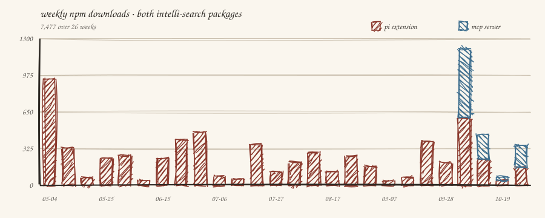

<!-- Generated from the repository README.md by scripts/generate-package-readmes.mjs. Edit the root README.md, then run npm run generate:readmes. -->

# pi-intelli-search

[](https://www.npmjs.com/package/@curio-data/pi-intelli-search)
[](https://www.npmjs.com/package/@curio-data/pi-intelli-search)
[](https://github.com/earendil-works/pi)
[](https://github.com/Curio-Data/pi-intelli-search/blob/main/LICENSE)


Intelligent web research for coding agents: search, extract, collate, and cache grounded web context in one tool call.

<p align="center">
  
</p>

**Features:**

- 🔍 **Search:** a search-grounded model, [_Perplexity Sonar_](https://docs.perplexity.ai) via [_OpenRouter_](https://openrouter.ai) by default. One application programming interface (API) key, no $50 minimum. Chat models with tool support also work through the web search server tool; see [native search settings](#openrouter-web-search-server-tool) or [Model Context Protocol (MCP) tuning](https://github.com/Curio-Data/pi-intelli-search/blob/main/README.md#tuning).
- 🔗 **Harvest:** provider-supplied citation links recovered from the response, alongside links in the answer. Recognised `url_citation` annotations are merged with text links before pages are selected; recovery is best-effort, not a complete record of sources consulted.
- 🌐 **Fetch:** Dual-fetch each page (Hypertext Markup Language (HTML) → [_Defuddle_](https://github.com/kepano/defuddle) versus Markdown endpoint), compare quality, pick the cleaner version.
- 📄 **Extract:** Per-page large language model (LLM) extraction guided by a _focused prompt_. Compresses ≈50K to ≈3-5K chars of query-relevant content.
- 🔗 **Collate:** Cross-source deduplication, inconsistency detection, and synthesis into a focused ≈5K-character summary.
- 🧠 **Reasoning-Aware Output Budget:** When a reasoning model spends its output cap on hidden reasoning, research retries at a doubled cap (8,000, then 16,000, then 32,000 tokens by default) before reporting a failure. See [Output Budget Retry](#output-budget-retry).
- 📏 **Long Pages, Bounded Collation:** Extraction reads up to 400,000 characters of each page. When the extractions exceed the [collation input budget](#collation-input-budget), the longest are trimmed at clean boundaries, and the result gives the path of each trimmed extraction's full saved file.
- 🧾 **Recoverable Failures:** When no extraction succeeds, research saves the fetched pages and a failure report; when synthesis fails, it saves the pages and extractions as well. The result names the saved files, so the agent can read them rather than repeat the paid stages. See [Extraction Diagnostics](#extraction-diagnostics).
- 📂 **Code and Text Sources:** Raw source files and text responses are saved and extracted alongside HTML pages. References named in search text without a link are fetched as labelled guesses; see [Inferred Assets](#inferred-assets).
- 💾 **Cache:** Persistent `.search/` cache with automatic cache suggest. Related previous searches surfaced on each query.
- 🎯 **Configurable:** Select models independently for search, extract and collate. The native extension uses registered, authenticated `Pi` models (capability and context limits apply); the MCP server uses explicitly selected OpenRouter models.
- 💰 **Cost:** see the [default research-run estimate](#cost).

`@curio-data/pi-intelli-search` registers four research tools natively in [`Pi`](https://github.com/earendil-works/pi), using its settings, authentication and model registry. [Install the extension](#pi-native-extension) to get started.

For other coding agents, the sibling `@curio-data/mcp-intelli-search` package serves the same engine and cache format through the Model Context Protocol (MCP). See [MCP installation](https://github.com/Curio-Data/pi-intelli-search/blob/main/README.md#mcp-server).

The shared pipeline searches via a search-grounded model ([_Perplexity Sonar_](https://docs.perplexity.ai), the native default) and merges prose links with harvested citations before selecting pages. It fetches pages through a dual-fetch comparison ([_Defuddle_](https://github.com/kepano/defuddle) versus Markdown endpoint), then extracts query-relevant content per page with a dedicated large language model (LLM) guided by a _focused prompt_. Collation deduplicates findings, flags inconsistencies, and synthesises a concise summary. Reports, extractions and fetched content are cached for offline reuse in `.search/` by default. Cache suggest surfaces related previous searches on each query.

## Two Packages, One Engine

Choose the installation route for the host:

| Route | Host | What to Install |
|---|---|---|
| Native `Pi` Extension | `Pi` | `@curio-data/pi-intelli-search` |
| Direct MCP Registration | Any MCP-compatible host | `@curio-data/mcp-intelli-search` |
| Host Plugin | Claude Code or Codex | Repository marketplace launching the pinned MCP package |

The install branches: [`Pi` Native Extension](#pi-native-extension) and [MCP Server](https://github.com/Curio-Data/pi-intelli-search/blob/main/README.md#mcp-server), with host instructions for [Claude Code](https://github.com/Curio-Data/pi-intelli-search/blob/main/README.md#claude-code), [Codex](https://github.com/Curio-Data/pi-intelli-search/blob/main/README.md#codex) and any [Generic MCP Host](https://github.com/Curio-Data/pi-intelli-search/blob/main/README.md#generic-mcp-host).

The native extension uses `Pi` settings and authentication. Generic MCP registration requires explicit configuration and a workspace; the Codex launcher supplies project and model defaults. Inference uses an OpenRouter key supplied through the configured environment variable or credential file. The MCP server does not read `Pi` settings or credentials.

## Contents

<!-- TOC:START -->

- [Two Packages, One Engine](#two-packages-one-engine)
- [Install](#install)
  - [`Pi` Native Extension](#pi-native-extension)
    - [Prerequisites](#prerequisites)
    - [Install the Extension](#install-the-extension)
    - [Verify Installation](#verify-installation)
    - [Release Notes After an Update](#release-notes-after-an-update)
    - [Customise (Optional)](#customise-optional)
- [Tools](#tools)
  - [Evidence and Provenance](#evidence-and-provenance)
  - [Inferred Assets](#inferred-assets)
  - [Extraction Diagnostics](#extraction-diagnostics)
    - [Output Budget Retry](#output-budget-retry)
  - [Collation Input Budget](#collation-input-budget)
- [Usage Examples](#usage-examples)
  - [Quick Search](#quick-search)
  - [Deep Research](#deep-research)
  - [Targeted Research With Domain Guidance](#targeted-research-with-domain-guidance)
  - [Comparing Options](#comparing-options)
- [Launch Blog Post](#launch-blog-post)
- [What It Adds Over Other Extensions](#what-it-adds-over-other-extensions)
- [Configuration Recipes](#configuration-recipes)
  - [Recipe 1: Zero Configuration](#recipe-1-zero-configuration)
  - [Recipe 2: Web Search Tool + Nano](#recipe-2-web-search-tool--nano)
  - [Recipe 3: Sonar Pro Search](#recipe-3-sonar-pro-search)
  - [Recipe 4: Pin Eight Pages](#recipe-4-pin-eight-pages)
  - [Recipe 5: Economy Extract and Collate](#recipe-5-economy-extract-and-collate)
  - [Recipe 6: Stronger Collation](#recipe-6-stronger-collation)
  - [Recipe 7: Free-Tier Resilience](#recipe-7-free-tier-resilience)
  - [Recipe 8: Per-Project Override](#recipe-8-per-project-override)
  - [Recipe 9: Large-Context Collation](#recipe-9-large-context-collation)
  - [Recipe 10: Bounded Time and Spend](#recipe-10-bounded-time-and-spend)
- [Model Configuration](#model-configuration)
  - [OpenRouter Routing for Sonar](#openrouter-routing-for-sonar)
  - [Source Harvesting from Citations](#source-harvesting-from-citations)
  - [OpenRouter Web Search Server Tool](#openrouter-web-search-server-tool)
    - [searchWebSearch Keys](#searchwebsearch-keys)
  - [Choosing an Alternative Search Configuration](#choosing-an-alternative-search-configuration)
  - [Swapping the Extract and Collate Model](#swapping-the-extract-and-collate-model)
  - [Model Selection Guidance](#model-selection-guidance)
  - [Required API Keys](#required-api-keys)
- [Pipeline](#pipeline)
- [Cost](#cost)
- [Settings](#settings)
  - [Settings Reference](#settings-reference)
  - [Automatic llms-full.txt Discovery](#automatic-llms-fulltxt-discovery)
- [Cache Structure](#cache-structure)
- [Compatibility](#compatibility)
  - [`Pi` Extension Compatibility](#pi-extension-compatibility)
- [Documentation](#documentation)
- [Downloads](#downloads)
- [Provenance](#provenance)
- [Sponsor](#sponsor)
- [Licence](#licence)
- [Use of Large Language Models](#use-of-large-language-models)

<!-- TOC:END -->

<a id="use-with-other-hosts"></a>
## Install

### `Pi` Native Extension

#### Prerequisites

Install `Pi` >= 0.86.0 and obtain an [OpenRouter](https://openrouter.ai) account. One key covers search, extraction and collation with the default models. Other providers are supported for extraction and collation; see [Model Configuration](#model-configuration).

1. **Sign In With OAuth (Recommended):** run `/login openrouter` in `Pi`. On `Pi` 0.82.0 and later this performs OpenRouter OAuth Proof Key for Code Exchange (PKCE) sign-in and stores a user-controlled key automatically. No manual key paste is required.
2. **Or add a key manually:** create one at [openrouter.ai/keys](https://openrouter.ai/keys), then edit `~/.pi/agent/auth.json`:

```json
{
  "openrouter": {
    "type": "api_key",
    "key": "sk-or-v1-..."
  }
}
```

#### Install the Extension

From `npm` (recommended):

```bash
pi install npm:@curio-data/pi-intelli-search
```

From _GitHub_:

```bash
pi install git:github.com/Curio-Data/pi-intelli-search
```

Local development:

```bash
pi install /path/to/pi-intelli-search
```

On first load, `Pi` shows `Added models:` followed by any missing models: on a fresh install these are `perplexity/sonar`, `perplexity/sonar-pro`, and `perplexity/sonar-pro-search`. An upgrade lists only models not already registered. A missing OpenRouter key produces a warning notification.

#### Verify Installation

Start `Pi` and type `/model`. Confirm that `perplexity/sonar`, `perplexity/sonar-pro`, and `perplexity/sonar-pro-search` appear in the model list. If they are missing after a manual edit, reopen `/model`: since `Pi` 0.82.0 the picker reloads `models.json` on open. Restart `Pi` only if they are still absent. Registration does not select a pipeline model; `searchModel` in settings does that.

#### Release Notes After an Update

On `Pi` 1.5.0 and later, the next fresh launch after a package update shows newer package release notes under Extension Updates. The first time `Pi` sees the package, it records the version without showing release notes. Notes come from [`PI_CHANGELOG.md`](https://github.com/Curio-Data/pi-intelli-search/blob/main/PI_CHANGELOG.md), a native-only changelog generated from the canonical [Changelog](https://github.com/Curio-Data/pi-intelli-search/blob/main/CHANGELOG.md) and declared to the host through `pi.changelogPath`. Hosts before 1.5.0 ignore the field and the file, so the package behaves the same on the supported floor of `Pi` 0.86.0. Set the top-level `Pi` setting `collapseChangelog` to `true` in `~/.pi/agent/settings.json` to show one line per updated package.

#### Customise (Optional)

No configuration is needed to get started. The defaults use OpenRouter for all stages. To limit research to six pages, add this block to `~/.pi/agent/settings.json` or, for a trusted project, `<project>/.pi/settings.json`:

```json
{
  "$schema": "https://pi.dev/schemas/settings.schema.json",
  "pi-intelli-search": {
    "defaultUrls": 6,
    "maxUrls": 6
  }
}
```

`Pi` 1.2.0 publishes the [settings schema](https://pi.dev/schemas/settings.schema.json) referenced by the optional `$schema` line. It provides editor validation and completion for host settings and permits the `pi-intelli-search` namespace without validating or completing its keys. The published [models schema](https://pi.dev/schemas/models.schema.json) accepts the Sonar registrations the extension writes.

See [Model Configuration](#model-configuration) for model selection, [Configuration Recipes](#configuration-recipes) for complete examples, and [Settings](#settings) for defaults and the full reference.

## Tools

Both packages expose these four operations. Start with `intelli_search` for factual questions, latest versions and release dates; use `intelli_research` for multi-page comparisons, detailed analysis or an evidence gap that search leaves unresolved. The names below are native `Pi` tool names and MCP server tool names; MCP hosts add their own callable-name prefixes. Use the names exposed by the host.

| Tool               | Description                                                                                         |
| ------------------ | --------------------------------------------------------------------------------------------------- |
| `intelli_search`   | Search the web and return a concise answer with a source list (top `defaultUrls`).                   |
| `intelli_extract`  | Extract query-relevant content from a web page, preserving code and technical detail verbatim.      |
| `intelli_collate`  | Deduplicate and synthesise multiple extractions into a summary. Writes cache.                       |
| `intelli_research` | Search, fetch, extract, collate and cache multi-page research in one call.                        |

The native `intelli_research` schema declares `minimum: 1` for `maxUrls`. `Pi` 1.2.0 codemode displays this as an `@minimum` constraint. The runtime default page budget and configured upper cap remain controlled by [Settings](#settings).

### Evidence and Provenance

Research collation receives only successful, non-empty page extractions, not the search model's summary. Code generates the Source Assessment inventory and cache-file references from the run's evidence manifest. Synthesis uses source IDs such as `[S1]`; unknown IDs, prose URLs absent from the supplied extractions and model-generated numbered cache references fail validation before a report is committed. Cross-links present in extracted text remain content, not additional fetched pages. Fenced, indented and inline code examples remain code, not evidence declarations. These checks establish reference consistency, not factual accuracy.

Manual `intelli_collate` labels its evidence as caller-supplied extractions; it does not claim the server fetched those pages. An extraction passed with `inferred: true` is treated as a guessed source: the synthesis model is told so, and the collation budget trims it before cited sources. Empty or duplicate source evidence is rejected. The optional `searchSummary` input remains accepted for compatibility but does not supply synthesis evidence. Per-source relevance and contribution ratings are no longer model-generated. Read exact cache paths from the inventory; `Not cached` means no full-page file was supplied.

### Inferred Assets

Search text can name a site or file without linking it, for example `install.sh`, `manage.py/runserver` or `docs.example.com/guide`. When such a reference ends in a delegated top-level domain (TLD), it is kept as an inferred reference: normalised to an `https://` URL, labelled inferred from text rather than a citation, and ranked after linked and cited URLs, so a guess cannot displace a citation from the `maxUrls` selection. The token becomes the host name, so `install.sh` fetches `https://install.sh`, and the fetch result records what that address served. Internationalised domain names are converted to their ASCII form, queries, fragments and numeric ports are kept, and a non-numeric port is rejected. `intelli_search` marks such sources `(inferred from text, not a citation)` with the original token. The label of a Markdown link to an absolute URL is not a reference: in `[the README.md](https://github.com/...)` only the link target is a source.

Every fetched URL, cited or inferred, passes one media gate. HTML and Markdown responses are cleaned as pages; plain-text and source-code media types, such as `text/plain`, `application/json` or `text/x-python`, are saved as text or code files. Binary responses, including PDF, are rejected. A saved inferred asset uses the normal numbered `sources/` file.

Research runs that reach extraction list every inferred reference in an `Inferred Assets` table in the result and in `report.md`; a `fetch-failed` result labels inferred URLs in its failed list. Each row shows the original token, the normalised URL, the fetch result (page, code file, text file, or nothing fetched with its reason) and the saved `sources/` path. A redirect or Markdown alternate records the final URL; a change of hostname other than a leading `www.` is shown as "redirected to a different host", which identifies a different hostname, not necessarily a different organisation. A code file is a media-type and file-extension classification, not proof of the source language. The same outcomes are in `details.inferredAssets`, with `url`, `outcome` (`page`, `code`, `text`, `unknown` or `nothing`) and, when known, `originalReference`, `alternateUrl`, `finalUrl`, `redirectedToDifferentHost`, `contentType`, `sourceFile` and `error`. A preserved run, which saved nothing, omits `sourceFile` and shows "Not saved in this attempt". The collation model receives inferred sources marked as guesses and is instructed not to give them citation-equivalent authority.

### Extraction Diagnostics

A completed research result can contain failed or incomplete sources. `details.pagesFailed` counts fetch failures; `details.extractionFailed` counts failures after a page was fetched. Inspect the **Failed Sources** list before relying on a report's coverage. A saved full-page link is provided only when that page was written to the cache.

The degraded outcomes differ in what they save:

- **`fetch-failed`:** every fetch failed. The result returns the search summary and up to ten failed URLs with their fetch errors, and saves no report or pages.
- **`extraction-failed`:** pages were fetched but no extraction succeeded. Research saves every fetched page under `sources/` and a failure report, and `details.cachePath` names the folder. The result's **Failed Sources** list, repeated under `## Failed Sources` in `report.md`, names each saved page's path and why its extraction failed. A saved page can be read directly, or passed to `intelli_extract` as content, without fetching it again.
- **`collate-failed`:** synthesis failed after extraction. Research saves the extractions and pages with a report that names the failure and lists the saved extractions.

When a successful report for the same query already exists from the same UTC date, including one committed by a concurrent run, an `extraction-failed` or `collate-failed` run preserves that report instead: this run's pages and extractions are not saved, `details.cachePath` is empty, and `details.preservedCachePath` names the preserved report's folder. An `extraction-failed` result still lists up to ten failed pages with their reasons. Neither failure outcome is added to the cache index or runs the cache-suggest judge.

Nonempty output that stops at its output cap, shown by finish reason `length` or by a reported token count that reaches the cap, is kept with a truncation warning. `intelli_extract` returns `details.truncated`; research and manual collation mark affected sources in the Source Assessment inventory. A synthesis warning applies to the summary itself. Without either signal, the absence of a warning does not establish completeness, and `outcome: "completed"` does not guarantee complete source coverage.

Research sidecars, when enabled, record extraction-budget failures, possible truncation, available serving routes and cache-judge degradation. See [Telemetry Sidecar](https://github.com/Curio-Data/pi-intelli-search/blob/main/docs/ARCHITECTURE.md#telemetry-sidecar) for field definitions and absence semantics. Standalone extraction and collation do not write this sidecar.

#### Output Budget Retry

Within research, an output cap that runs out is retried with the cap doubled, up to `outputBudgetRetries` times (default 2, so 8,000, then 16,000, then 32,000 tokens), never above 128,000 tokens or the model's output limit. An extraction is retried only when it stops at its cap without visible text; nonempty truncated extraction text is kept with its warning. A synthesis is retried when it stops at its cap with or without text, and a synthesis that keeps returning truncated text uses every configured retry. Of the syntheses returned, a completed one is always preferred over a truncated one; truncated candidates follow, longest first, and the first candidate that passes source validation is used. Set `outputBudgetRetries` to `0` to disable the retry. Standalone `intelli_extract` and manual `intelli_collate` do not retry with a larger cap.

A retry never exceeds the model's output limit, and a retry that would grow the cap by less than a quarter is skipped, so a limit can shorten the sequence or remove the retry. The native extension reads the limit from the model's `maxTokens` in the `Pi` model registry. `Pi` assigns 16,384 to a custom model defined without `maxTokens`, so such a model's default sequence is 8,000 then 16,000 tokens. To allow larger retries, set `maxTokens` in `models.json` to the provider's stated limit: in the model's `models` entry for a custom model, or in a `modelOverrides` entry for a built-in model. The MCP server reads the limit from the OpenRouter catalogue, and no setting overrides it. A configured cap at or above the model's output limit gets no retry, and neither does a configured cap above 102,400 tokens, because its doubled cap held to 128,000 would be less than a quarter larger. Research always requests the configured cap unchanged. A failure reason names the model's limit when it prevented a larger attempt.

Each attempt's timeout scales with its cap, `llmTimeoutMs × attemptCap / configuredCap`, and is capped at four times `llmTimeoutMs`: 120, 240 and 480 seconds with the defaults. One page's budget attempts can therefore take 14 minutes, and the transport retries set by `llmRetryAttempts` repeat a timed-out attempt, so a failing page can take ≈30 minutes or more. With the default two retries, the budget attempts of one call can bill up to seven times the configured cap in output (8,000 + 16,000 + 32,000 tokens), and each transport retry of an attempt can bill again. A diagnostic or warning reports the cap of the attempt it describes.

For a budget-exhaustion diagnostic that survives the retries, review `extractionMaxTokens` for page extraction or `collationMaxTokens` for synthesis. On reasoning models, the budget includes reasoning as well as visible text. Increase the relevant cap within the model's output and context limits, or select a model with a smaller reasoning requirement. Lowering reasoning effort did not prevent exhaustion on the serving route identified in the investigation; it is not a guaranteed remedy. Read an available saved page before repeating paid research. Raising `llmTimeoutMs` addresses timer expiry, not an exhausted token budget or a host deadline.

A higher completion cap can permit more billable output and increase OpenRouter's in-flight credit reservation. The [Cost](#cost) estimate is a planning figure, not a spending limit; raising a cap does not mean every call consumes it.

### Collation Input Budget

Research and manual collation size the collation input at ≈4 characters per token. Each extraction is first capped at `collationSourceMaxTokens` (default 32,000 tokens), counted in its own characters. The total is measured as the space the extractions take in the collation request, which is JSON, so a newline, quote or backslash counts as two characters: an extraction heavy in code or tables uses more of the budget than its length suggests. Each source is also charged at least ≈100 tokens of header, more when its URL or title is long. If the total still exceeds `collationInputBudgetTokens` (default 221,000), the longest extractions are trimmed to a fair share of the budget, inferred references before cited sources. Whole sources are left out only when a fair share would keep too little to be useful, lowest-ranked first and inferred references first. Within research, the per-source cap binds only when an extraction's largest retried cap (`extractionMaxTokens` doubled `outputBudgetRetries` times, 32,000 tokens with the defaults) exceeds it, or when a page's text runs above ≈4 characters per token. In manual `intelli_collate` it applies to whatever the caller supplies. Trimming changes only the text sent to the collation model; saved extraction files are never altered.

Every cut ends at a paragraph, line, sentence or word boundary where one is near, and backs off before a Markdown link, a URL or an open code block it would split, so the model is not shown half a link it might complete from memory, which would fail provenance validation. The back-off never discards more than half of the kept text, so a code block or token that began in the first half keeps the plain cut.

A synthesis that cites a URL found only in the omitted text fails provenance validation, because that URL is not in the evidence the model received. Research then uses another synthesis already received from an output-cap retry when there is one, and otherwise ends as `collate-failed`; manual collation returns the error. The error names the first rejected URL; in research, a reason longer than 300 characters is shortened, so a very long URL can appear cut off. A saved `collate-failed` report also carries the **Collation input trimmed** notice described below: search the listed extraction files for the URL to see whether it was in the omitted text or in none of the sources.

When anything was trimmed, the result and `report.md` carry a **Collation input trimmed** notice. It names the limit that bound: the per-source limit (`collationSourceMaxTokens`), the total input budget (`collationInputBudgetTokens`), or both. It lists each affected source under "Trimmed to the per-source limit", "Trimmed by both limits", "Trimmed to a fair share of the input budget", "Left out with empty retained text" or "Left out to fit the input budget", with the extraction characters sent and the path of its untrimmed extraction file, including the cache folder, ready to open from the workspace. The notice states that the omitted text is in those files and that re-running research does not recover it; read them for the missing detail. Its **Configuration** line names the setting to raise next time. Raising `collationSourceMaxTokens` sends more of one long page; raising `collationInputBudgetTokens`, within the collation model's context, or requesting fewer URLs sends more overall. Raising only the total budget does not recover text removed by the per-source cap. When a limit is already at its maximum, the notice says so instead of advising a raise.

If the limits leave no extraction text at all, the synthesis model is not called. Research returns `collate-failed` with the extractions and pages saved, and manual `intelli_collate` returns an error; both name `collationInputBudgetTokens` and `collationSourceMaxTokens` as the settings to raise.

<a id="quick-start"></a>
## Usage Examples

These examples describe tool calls for the agent, not shell commands. MCP hosts add their own tool-name prefixes.

### Quick Search

```text
intelli_search(query="TypeScript 5.8 release date")
```

### Deep Research

Always provide a `focusPrompt`. The extraction LLM works best with specific guidance.

```text
intelli_research(
  query="Svelte 5 runes tutorial examples",
  focusPrompt="Extract the core rune concepts ($state, $derived, $effect), their syntax, and how they replace the old reactive declarations. Include migration patterns from Svelte 4."
)
```

### Targeted Research With Domain Guidance

```text
intelli_research(
  query="Cloudflare Workers KV write timeout limits",
  focusPrompt="Extract KV write limits, timeout thresholds, storage limits, and any workarounds for bulk writes. Focus on hard numbers and error messages.",
  maxUrls=3,
  domains=["developers.cloudflare.com"]
)
```

`domains` guides source selection, it is not a security boundary: the query gains a `site:` expression, and with the web search tool enabled the same domains are also combined with `searchWebSearch.allowedDomains` and sent as an engine filter. The lists are combined, not intersected, and returned uniform resource locators (URLs) are not checked against a local hostname allowlist before fetching. Engine support for allow and exclude lists differs; see [native searchWebSearch keys](#searchwebsearch-keys) or [MCP tuning](https://github.com/Curio-Data/pi-intelli-search/blob/main/README.md#tuning).

### Comparing Options

```text
intelli_research(
  query="Tailwind CSS vs Vanilla Extract comparison 2026",
  focusPrompt="Extract pros/cons, bundle size benchmarks, DX tradeoffs, and migration costs. Note which claims come from official sources vs blog opinions."
)
```

## Launch Blog Post

<p align="center">
  <a href="https://blog.curiodata.pro/posts/22-pi-intelli-search/">
    
  </a>
</p>

Read the launch post, [_pi-intelli-search: LLM-Native Web Research for the Pi Coding Agent_](https://blog.curiodata.pro/posts/22-pi-intelli-search/), for the design story behind the pipeline: why the pipeline extracts query-relevant content before collation, how collation keeps the agent context clean, and the launch-era estimate of ≈$0.05 per session. The [Cost](#cost) section holds the current default estimate.

## What It Adds Over Other Extensions

<p align="center">
  
</p>

*The comparison illustration shows the default configuration and cost at its creation; search is configurable (see [Model Configuration](#model-configuration)).*

Four capabilities distinguish `intelli-search` within the seven-extension [May 2026 comparison](https://github.com/Curio-Data/pi-intelli-search/blob/main/docs/COMPARISON.md#scope):

1. **Dual-fetch quality comparison.** Every page is fetched twice in parallel (Defuddle versus Markdown endpoint), scored, and the better version wins. Server-rendered Markdown is not guaranteed to be cleaner than HTML; the comparison catches this automatically.
2. **Per-page LLM extraction guided by `focusPrompt`.** Each page is compressed to ≈3-5K chars of query-relevant content before entering the agent's context. Extraction quality scales with the chosen model.
3. **LLM collation with deduplication.** A collation model synthesises across sources, flags conflicting claims, and preserves source attribution. The agent does not spend reasoning tokens on mechanical synthesis.
4. **Persistent cache with cache suggest.** Full pages and extractions are kept in `.search/` and indexed. An LLM judge surfaces related previous searches after each live query. Manually reusing a cached report can avoid a subsequent research call; cache suggest does not skip the current search.

The collation prompt targets a concise ≈5K-character summary; actual length depends on the selected model and output budget. The full page content stays in the cache, accessible via native `Pi` tools like `read` or `grep` for deeper inspection. Among the seven extensions in the May 2026 comparison, only `intelli-search` combines per-page extraction and a persistent structured cache.

For the detailed feature-by-feature comparison against six other `Pi` search extensions, see [docs/COMPARISON.md](https://github.com/Curio-Data/pi-intelli-search/blob/main/docs/COMPARISON.md).

## Configuration Recipes

These recipes configure the native `Pi` extension. For MCP configuration, select models under `models` and tuning under `tuning` in the [standalone configuration file](https://github.com/Curio-Data/pi-intelli-search/blob/main/README.md#configuration); do not copy the native settings wrapper.

Each recipe is a complete `~/.pi/agent/settings.json`. Copy it whole, or merge the `pi-intelli-search` block into an existing file. Project-level overrides go in `<project>/.pi/settings.json` (applies only after `Pi` approves the project; the global file always applies).

Two loader rules to keep in mind:

- A configured object replaces its default wholesale. The `searchWebSearch` block and the model blocks have no per-key merge: supply every required key.
- Nested `pi-intelli-search` keys always win over the deprecated flat `intelli*` keys.

| Purpose | Recipe |
|---|---|
| Works immediately, nothing to write | [Zero Configuration](#recipe-1-zero-configuration) |
| A chat model plus the web search server tool | [Web Search Tool + Nano](#recipe-2-web-search-tool--nano) |
| Sonar Pro Search via a model swap | [Sonar Pro Search](#recipe-3-sonar-pro-search) |
| The pre-0.13 page count | [Pin Eight Pages](#recipe-4-pin-eight-pages) |
| Cheaper extraction and collation | [Economy Extract and Collate](#recipe-5-economy-extract-and-collate) |
| Better final summaries | [Stronger Collation](#recipe-6-stronger-collation) |
| A free-tier or shared OpenRouter key | [Free-Tier Resilience](#recipe-7-free-tier-resilience) |
| A different search model for one repo only | [Per-Project Override](#recipe-8-per-project-override) |
| Wide runs with a large-context collate model | [Large-Context Collation](#recipe-9-large-context-collation) |
| A short host deadline or predictable spend | [Bounded Time and Spend](#recipe-10-bounded-time-and-spend) |

Recipes 2 and 3 run end-to-end in `08_websearch_tool.sh` and `09_sonar_pro_search.sh`; every other recipe runs in its own isolated environment in [`test/e2e/10_config_recipes.sh`](https://github.com/Curio-Data/pi-intelli-search/blob/main/test/e2e/10_config_recipes.sh). Each script's header states what it proves.

### Recipe 1: Zero Configuration

Write nothing. The defaults provide Sonar search with citation harvesting, MiniMax M3 extraction and collation, up to 10 pages per research run, and the `.search/` cache. Every other recipe below changes exactly one concern from this baseline.

### Recipe 2: Web Search Tool + Nano

An OpenRouter chat model with server-tool support can use live search through `openrouter:web_search`; search does not require a search-native model family. The September 2026 probe estimate for this pairing is ≈$0.008 per search, not a lowest-cost ranking. In that configuration, `reasoning: "minimal"` leaves more of the completion budget available for answer text; unconstrained reasoning can consume it.

```jsonc
{
  "pi-intelli-search": {
    "searchModel": {
      "provider": "openrouter",
      "model": "openai/gpt-5-nano"
    },
    "searchWebSearch": {
      "enabled": true,
      "engine": "exa",
      "maxResults": 8,
      "reasoning": "minimal"
    },
    "extractModel": {
      "provider": "openrouter",
      "model": "minimax/minimax-m3"
    },
    "collateModel": {
      "provider": "openrouter",
      "model": "minimax/minimax-m3"
    }
  }
}
```

### Recipe 3: Sonar Pro Search

Agentic multi-step search on the Perplexity stack, reached through a settings-only model swap. The recorded estimate is ≈$0.05 per search ($18 per 1,000 requests plus tokens); it is not a comparative quality measurement. `searchWebSearch` is disabled explicitly so this recipe also applies after previously enabling the tool.

```jsonc
{
  "pi-intelli-search": {
    "searchModel": {
      "provider": "openrouter",
      "model": "perplexity/sonar-pro-search"
    },
    "searchWebSearch": {
      "enabled": false
    },
    "extractModel": {
      "provider": "openrouter",
      "model": "minimax/minimax-m3"
    },
    "collateModel": {
      "provider": "openrouter",
      "model": "minimax/minimax-m3"
    }
  }
}
```

### Recipe 4: Pin Eight Pages

v0.13.0 raised `defaultUrls` to 10 and `maxUrls` to 20 because citation harvesting fills the URL list. To retain the earlier page-count settings, pin both values. This recipe previously recorded ≈$0.004 per extracted page without specifying an input/output budget. That unscoped figure is historical, not the default M3 estimate in [Cost](#cost).

```jsonc
{
  "pi-intelli-search": {
    "defaultUrls": 8,
    "maxUrls": 16
  }
}
```

### Recipe 5: Economy Extract and Collate

A full 10-page research run makes 10 extraction calls and one collation call, so token rates dominate cost. Swap both stages to a cheaper OpenRouter model; search is untouched. Select a registered, authenticated model with sufficient text-processing capability and context for these stages.

```jsonc
{
  "pi-intelli-search": {
    "extractModel": {
      "provider": "openrouter",
      "model": "google/gemini-3.7-flash"
    },
    "collateModel": {
      "provider": "openrouter",
      "model": "google/gemini-3.7-flash"
    }
  }
}
```

Convert `extractMaxChars` to an estimated input-token budget (the default 400K chars is ≈100K tokens), then add prompt tokens and reserve `extractionMaxTokens` for output. Lower the character limit if that total exceeds the model's token window.

### Recipe 6: Stronger Collation

Keep extraction cheap and spend on the final synthesis, where cross-source reasoning and contradiction-flagging live. Only `collateModel` changes.

```jsonc
{
  "pi-intelli-search": {
    "collateModel": {
      "provider": "openrouter",
      "model": "openai/gpt-5-mini"
    }
  }
}
```

### Recipe 7: Free-Tier Resilience

For an observed account limit of approximately 0.33 requests per second, the default fan-out of up to 4 concurrent extractions can exceed the limit. Space the calls, lengthen the retries, and shrink the page count. This recipe is a response to observed limits, not a provider-wide quota claim about free-tier keys.

```jsonc
{
  "pi-intelli-search": {
    "defaultUrls": 5,
    "minRequestIntervalMs": 3000,
    "extractionConcurrency": 2,
    "llmRetryAttempts": 4,
    "llmTimeoutMs": 120000
  }
}
```

Choose pacing, concurrency and retry settings from observed account and provider rate limits, whether the key is paid, free-tier or shared. Leave the throttle off when the account handles the default fan-out without rate-limit failures. The explicit `llmTimeoutMs` retains the current default while this recipe changes pacing, concurrency and retry attempts.

### Recipe 8: Per-Project Override

A trusted project can override individual keys for one repository only. Put the override in `<project>/.pi/settings.json`; everything not listed keeps its global value.

```jsonc
{
  "pi-intelli-search": {
    "searchModel": {
      "provider": "openrouter",
      "model": "perplexity/sonar-pro-search"
    },
    "cacheDir": ".search-client-x"
  }
}
```

Use this to give a client project a dedicated cache directory and a stronger search model while every other project stays on the global defaults.

### Recipe 9: Large-Context Collation

The default `collationInputBudgetTokens` (221,000) keeps the collation request within the range in which MiniMax M3 was observed to work well. An extraction that is retried twice may return up to 32,000 tokens, the default `collationSourceMaxTokens`, so a run at the default `maxUrls` of 20 can in the worst case offer ≈640,000 tokens of extractions, and the default budget trims it. A collate model with a larger context and a larger budget lets more of each extraction reach the synthesis. _Gemini_ 3.7 Flash lists a context of ≈1M tokens and 65,536 output tokens on OpenRouter.

```jsonc
{
  "pi-intelli-search": {
    "collateModel": {
      "provider": "openrouter",
      "model": "google/gemini-3.7-flash"
    },
    "collationInputBudgetTokens": 600000
  }
}
```

Keep the budget, the prompts and the largest retried synthesis cap (32,000 tokens with the defaults) within the model's context. Runs whose extractions stay at ≈3-5K characters each are not trimmed at either budget. A larger budget is billed as collation input when the extractions fill it; see [Cost](#cost) and [Collation Input Budget](#collation-input-budget).

### Recipe 10: Bounded Time and Spend

Release 0.22.0 added output budget retries and raised `extractMaxChars` and `collationMaxTokens`, and each can lengthen a research call or raise its cost. Where the host deadline is short or spend must stay predictable, restore the 0.21.0 values:

```jsonc
{
  "pi-intelli-search": {
    "outputBudgetRetries": 0,
    "extractMaxChars": 150000,
    "collationMaxTokens": 4000
  }
}
```

With these values an output cap that runs out is not retried: an extraction with no visible text fails with a budget-exhaustion diagnostic, and a synthesis that reaches 4,000 tokens is kept truncated with a warning, or ends the run as `collate-failed` when it has no text. On a reasoning collate model such as MiniMax M3, 4,000 tokens is the cap at which the synthesis failures that 0.22.0 corrects were recorded. Each model call keeps the `llmTimeoutMs` limit, and long pages are cut at 150,000 characters (≈37,500 tokens), which can fall before the sections that answer the query. Lower `llmRetryAttempts` and `maxUrls` as well where the host deadline is shorter still. [Extraction Diagnostics](#extraction-diagnostics) gives the timing of each budget attempt.

## Model Configuration

Both packages select models independently for search, extract and collate. The configuration below is for the native `Pi` extension. Generic MCP registration requires explicit OpenRouter selections for all three roles in its [configuration file](https://github.com/Curio-Data/pi-intelli-search/blob/main/README.md#configuration); Codex mode supplies the documented defaults when no per-user file exists.

Native defaults are chosen for cost-efficiency. Registered, authenticated models from built-in providers, [OpenRouter](https://openrouter.ai) or other extensions can replace them, subject to role suitability and context limits. Search needs grounding or supported web-search tools; registry access alone does not establish that capability.

| Stage   | Default                       | Config Key              |
| ------- | ----------------------------- | ----------------------- |
| Search  | `openrouter/perplexity/sonar` | `searchModel`           |
| Extract | `openrouter/minimax/minimax-m3` | `extractModel`      |
| Collate | `openrouter/minimax/minimax-m3` | `collateModel`      |

<a id="why-openrouter-for-sonar"></a>
### OpenRouter Routing for Sonar

[_Perplexity Sonar_](https://docs.perplexity.ai) is a search-grounded model, but it is not in `Pi`'s built-in model list. Rather than requiring a separate Perplexity API account (which requires a $50 minimum credit top-up), the extension routes _Sonar_ through [OpenRouter](https://openrouter.ai). _OpenRouter_ is a unified pay-as-you-go API with a lower minimum spend. One API key provides access to Sonar and other catalogue models, subject to account permissions. On first load, the extension patches `~/.pi/agent/models.json` to add _Sonar_ under the `openrouter` provider so `Pi` can discover it. This approach has several benefits:

- **Avoids the Perplexity API $50 minimum.** Routing through `OpenRouter` consolidates spend on a single account already used across the open-source coding-agent ecosystem, including `Pi`. No separate _Perplexity_ subscription is required.
- **One account, many models.** The same OpenRouter key covers Sonar and other accessible models selected for extraction or collation.
- **Non-Destructive Registration:** The patch merges new models by ID. It never replaces existing OpenRouter models.
- **Idempotence:** It is safe across extension reloads and updates.

The same single-key argument covers the alternative search configurations: the [web search server tool](#openrouter-web-search-server-tool) and [`perplexity/sonar-pro-search`](#choosing-an-alternative-search-configuration) both route through the same OpenRouter account.

### Source Harvesting from Citations

Search-grounded models can return machine-readable `url_citation` annotations identifying cited sources. The recovered set can exceed the prose links (recorded Sonar probe: 20 annotations against 3 prose links), but it does not establish every source consulted. `Pi`'s chat-completions adapter does not retain those annotations in the normalised response. Native citation recovery uses two channels: `onProviderStreamEvent` receives parsed provider chunks on `pi-ai` >= 0.99.0, while a tee of the raw response body remains the fallback for hosts whose `pi-ai` predates 0.99.0. Both channels feed one deduplicated per-attempt sink. The pipeline merges recovered citations with text links before selecting pages for fetching.

Collection is attempted on every search call regardless of model and needs no configuration. Native calls await background citation reads for up to two seconds; collection failure leaves the text-link path intact without failing the search. Text links come first; annotation-only links follow; exact URL duplicates are removed. `intelli_research` applies its URL limit after merging, so not every discovered source is fetched. Harvesting is best-effort: a model that emits no annotations, or annotations the parser does not recognise, leaves the text-link path intact. `intelli_search` caps its rendered source list at `defaultUrls` (top 10 by default). The count is recorded in `meta.json` as `stages.search.annotationsHarvested`.

### OpenRouter Web Search Server Tool

The search stage normally relies on a search-native model (default: _Sonar_). The `searchWebSearch` setting decouples it: [OpenRouter](https://openrouter.ai)'s `openrouter:web_search` server tool gives the configured chat model access to live web search, so the pipeline is not tied to any search-native model family. The tool is beta upstream; the model decides whether and how many times to search, and search charges depend on the engine, the number of server-side searches, and token usage. `maxResults` limits results per search and `maxUrls` limits pages fetched; neither caps total search spend.

`searchWebSearch` requires `searchModel.provider` to be `openrouter`. The tool ID is OpenRouter-specific; on any other provider the setting is ignored without warning.

A probe-validated pairing (2026-09): `openai/gpt-5-nano` with engine `exa` and `reasoning: "minimal"`, at ≈$0.008 per search with 5-17 cited sources:

```jsonc
{
  "pi-intelli-search": {
    "searchModel": {
      "provider": "openrouter",
      "model": "openai/gpt-5-nano"
    },
    "searchWebSearch": {
      "enabled": true,
      "engine": "exa",
      "maxResults": 8,
      "reasoning": "minimal"
    }
  }
}
```

#### searchWebSearch Keys

A supplied object replaces the entire default object; there is no per-key merge. A trusted project's object also replaces the global one. Omitting `reasoning` gives `low`, not `minimal`; omitting `maxResults` sends no result-count override and OpenRouter applies its own default (5).

| Key | Values | Notes |
|---|---|---|
| `enabled` | `true`, `false` | Off by default. Requires `searchModel.provider` to be `openrouter`. |
| `engine` | `auto`, `native`, `exa`, `parallel`, `perplexity`, `firecrawl` | `auto` (and unrecognised values) are omitted from the payload, leaving OpenRouter's default. |
| `maxResults` | 1-25 (1-20 on `perplexity`) | Rounded and clamped by the extension. Per engine search, not per research run. |
| `searchContextSize` | `low` (≈5K chars), `medium` (≈15K), `high` (≈30K) | Engine-specific budgets; some engines ignore it. |
| `allowedDomains` | array of domains | Combined (not intersected) with the per-call `domains` tool parameter. Cannot be combined with `excludedDomains` except on `exa`. |
| `excludedDomains` | array of domains | As above. |
| `reasoning` | `minimal`, `low`, `medium`, `high` | Falls back to `low` when omitted. Use `minimal` explicitly with GPT-5 family models to limit reasoning expenditure under the recorded tool configuration. |

The extension exposes a subset of the server tool's parameters. Upstream `mode`, `max_uses`, `max_total_results`, `max_characters`, and `user_location` are not settable through this block. The `firecrawl` engine additionally requires a separate [_Firecrawl_](https://www.firecrawl.dev/) account configured with OpenRouter (bring your own key, or BYOK); the other engines bill through OpenRouter credits.

### Choosing an Alternative Search Configuration

The default search model is `perplexity/sonar` (≈$0.007 per search). Two configurable alternatives use the same OpenRouter account:

| Option | Model | Setting | Cost per Search |
|---|---|---|---|
| Server tool | `openai/gpt-5-nano` + `engine: "exa"` | `searchWebSearch.enabled: true` | ≈$0.008 |
| Model swap | `perplexity/sonar-pro-search` | `searchModel` only | ≈$0.05 |
| Current default | `perplexity/sonar` | none | ≈$0.007 |

The model swap is settings-only:

```jsonc
{
  "pi-intelli-search": {
    "searchModel": {
      "provider": "openrouter",
      "model": "perplexity/sonar-pro-search"
    },
    "searchWebSearch": {
      "enabled": false
    }
  }
}
```

`perplexity/sonar-pro-search` bills $18 per 1,000 requests on top of $3/$15 per 1M tokens ([model card](https://openrouter.ai/perplexity/sonar-pro-search)). It buys agentic multi-step search; it is not the cheap option. Explicitly disabling `searchWebSearch` in the example makes it safe to apply after previously enabling the server tool: changing `searchModel` alone does not clear that separate setting.

### Swapping the Extract and Collate Model

[_MiniMax_](https://minimax.io) M3 (via OpenRouter) is the native default. In [baseline runs 1A, 2A, 1B, 2B and 3C](https://github.com/Curio-Data/pi-intelli-search/blob/main/docs/BENCHMARKS.md#baseline-findings), its collations stated their ranking methodology, caveated low-evidence claims and flagged compatibility warnings. M3's recorded ≈1M-token window provides input headroom at the default character limit. M3 and M2.7 had equal per-token pricing in that benchmark, while M3 wrote ≈2× the extraction characters. The recorded default-switch estimate projected doubled extract-stage output-token cost, not whole-session cost; the character measurements alone do not establish a token ratio (see [Decision Recorded](https://github.com/Curio-Data/pi-intelli-search/blob/main/docs/BENCHMARKS.md#decision-recorded)). Selecting `minimax/minimax-m2.7` requests leaner extractions, but values matching an upgrading version's historical default remain eligible for model migration; the migration is match-based, not intent-based, so an explicit selection equal to a previous default is still migrated (see [Decision Recorded](https://github.com/Curio-Data/pi-intelli-search/blob/main/docs/BENCHMARKS.md#decision-recorded)). Other registered, authenticated text models can also be selected, subject to capability and context limits. Override in `~/.pi/agent/settings.json` or `.pi/settings.json`:

**Option A: Use a `Pi` Built-In Provider** (auth via `/login`):

```jsonc
{
  "pi-intelli-search": {
    "extractModel": {
      "provider": "openai",
      "model": "gpt-4o-mini"
    },
    "collateModel": {
      "provider": "openai",
      "model": "gpt-4o-mini"
    }
  }
}
```

**Option B: Use Another OpenRouter Model** (same key, no extra setup):

```jsonc
{
  "pi-intelli-search": {
    "extractModel": {
      "provider": "openrouter",
      "model": "google/gemini-2.0-flash-001"
    },
    "collateModel": {
      "provider": "openrouter",
      "model": "google/gemini-2.0-flash-001"
    }
  }
}
```

**Option C: Use a Model Provided by Another Extension** (for example, Z.Ai or local models):

```jsonc
{
  "pi-intelli-search": {
    "extractModel": {
      "provider": "zai",
      "model": "glm-5.1"
    },
    "collateModel": {
      "provider": "zai",
      "model": "glm-5.1"
    }
  }
}
```

The model must be registered in `Pi`'s model registry, have authentication configured and support the required text operation within its context and output limits. Run `/login` to set up built-in providers, or follow the extension's own setup for extension-provided models.

### Model Selection Guidance

For extraction and collation, the ideal model has:

- **Low Cost per Token:** Up to 10 extractions, 1 collation and 1 cache suggestion per default research run, before retries.
- **Good Instruction Following:** Must adhere to extraction prompts precisely.
- **Sufficient Context:** Cleaned pages can be ≈50K chars; long pages are truncated to `extractMaxChars`, ≈100K tokens at the default.

Models known to work well for extraction and collation: _MiniMax_ M3 (default, ≈1M context, via OpenRouter), MiniMax M2.7 (leaner extractions in the recorded benchmark, via OpenRouter), _Qwen_ 3.5-Flash (≈1M context, ≈$0.26/M output), _DeepSeek_ V4 Flash (≈1M context, ≈$0.28/M output), _Gemini_ 2.0 Flash Lite (≈1M context, ≈$0.30/M output), _GPT-4.1_ Nano (≈1M context, ≈$0.40/M output).

### Required API Keys

With default settings, one key is required in `~/.pi/agent/auth.json`:

```json
{
  "openrouter": {
    "type": "api_key",
    "key": "sk-or-v1-..."
  }
}
```

A single [OpenRouter](https://openrouter.ai) key is the minimum required. It covers the default search model (Sonar) plus MiniMax M3 for extraction and collation with the default models. The extract and collate stages can use other registered, authenticated text models with suitable capabilities and context limits. Override `extractModel` or `collateModel` in settings to switch providers.

Run `/login openrouter` in `Pi` to authorise via OAuth (`Pi` 0.82.0 and later), or edit the file directly with a key from [openrouter.ai/keys](https://openrouter.ai/keys).

## Pipeline

<p align="center">
  
</p>

The illustration shows the native pipeline with the model configuration at its creation, including MiniMax M2.7 and `Pi` authentication; it does not show the current defaults or standalone authentication. All model assignments are configurable through [native model settings](#model-configuration) or [MCP configuration](https://github.com/Curio-Data/pi-intelli-search/blob/main/README.md#configuration); alternative search configurations use the same five-stage pipeline.

The search stage merges text links with harvested citation annotations before selecting pages (see [Source Harvesting from Citations](#source-harvesting-from-citations)), and ranks [inferred references](#inferred-assets) after both. Each page is dual-fetched (HTML via Defuddle versus Markdown endpoint) and scored for quality; plain-text and source files are saved as fetched. Per-page extraction (guided by `focusPrompt`) compresses ≈50K chars to ≈3-5K of query-relevant content before collation, keeping the total context manageable (≈30-50K for 10 pages). The [collation input budget](#collation-input-budget) trims unusually long extractions before synthesis.

Completed runs and the degraded exits recorded in `outcome` (`no-links`, `fetch-failed`, `extraction-failed`, `collate-failed`) attempt to write a local-only `meta.json` telemetry sidecar into the cache directory (see [Cache Structure](#cache-structure)). Set `"disableTelemetry": true` in the native `pi-intelli-search` namespace or the MCP `tuning` object to suppress it. Budget diagnostics and their absence semantics are defined in [Telemetry Sidecar](https://github.com/Curio-Data/pi-intelli-search/blob/main/docs/ARCHITECTURE.md#telemetry-sidecar); the [script guide](https://github.com/Curio-Data/pi-intelli-search/blob/main/scripts/README.md#reported-metrics) explains the available aggregates.

See [docs/ARCHITECTURE.md](https://github.com/Curio-Data/pi-intelli-search/blob/main/docs/ARCHITECTURE.md) for detailed design decisions.

## Cost

The estimate below uses the native default models and tuning, also selected in the minimal MCP configuration example. It is a planning estimate based on the recorded September 2026 price basis, not a live tariff check. Both packages incur inference charges on the configured provider account; MCP does not use host subscriptions or credentials.

Per research run with the default 10 pages: ≈$0.09

| Step                                | Calls                 | Cost      |
| ---------------------------------- | --------------------- | --------- |
| Search (Sonar)                      | 1                     | ≈$0.007   |
| Fetch (Defuddle + Markdown)         | 10 (≤4 concurrent) pairs | $0.00  |
| Extract (M3 via OpenRouter)         | 10 (≤4 concurrent)    | ≈$0.07    |
| Collate (M3 via OpenRouter)         | 1                     | ≈$0.01    |
| Cache Suggest (M3 via OpenRouter)   | 1                     | ≈$0.0002  |

Since v0.13.0 the search stage adds recovered provider citation URLs to prose links, increasing the candidate source set; `maxUrls` still caps page selection. The ≈$0.09 figure is the planning estimate for a full 10-page research run with the v0.14.0 default models (M3 and M2.7 had equal per-token prices in the recorded benchmark; M3 wrote ≈2× the extraction characters, with the cost estimate separately projecting greater token usage); lower `defaultUrls` to hold earlier spend. Changing the search model or engine also changes the search step's cost; configure it through [native model settings](#choosing-an-alternative-search-configuration) or [MCP configuration](https://github.com/Curio-Data/pi-intelli-search/blob/main/README.md#configuration). The extract and collate rows scale with the selected models.

The estimate assumes pages of ≈50K characters. `extractMaxChars` (default 400,000) caps the text sent to extraction at ≈100,000 input tokens per page, so a ten-page run over long pages can send ≈1M input tokens to the extract model before collation, at a correspondingly higher cost. Budget retries add output: with the default `outputBudgetRetries`, one affected call's budget attempts can bill up to seven times its configured output cap, before transport retries. Lower `extractMaxChars` or `outputBudgetRetries` to bound that spend.

## Settings

This section describes native `Pi` settings. The MCP server reads only its explicitly selected file; its accepted keys, ranges and policy differences are documented in [Configuration](https://github.com/Curio-Data/pi-intelli-search/blob/main/README.md#configuration) and [Tuning](https://github.com/Curio-Data/pi-intelli-search/blob/main/README.md#tuning).

No configuration is required. To override defaults, use `~/.pi/agent/settings.json` or, for a trusted project, `<project>/.pi/settings.json` under the `pi-intelli-search` namespace. `Pi` ignores project-local settings until the project is approved; the global file always applies.

Explicit tuning values are preserved on upgrade. Explicit model selections remain eligible for match-based migration when their provider and model match the upgrading version's historical default. Migration changes effective settings in memory, not the file (see `migrateDefaults()` in `src/settings.ts`).

The example below shows the default models and common tuning settings. The [Settings Reference](#settings-reference) lists every accepted namespace key:

```jsonc
{
  "pi-intelli-search": {
    // Model assignments (see Model Configuration above)
    "searchModel": {
      "provider": "openrouter",
      "model": "perplexity/sonar"
    },
    "searchWebSearch": {
      "enabled": false,
      "engine": "auto",
      "maxResults": 8,
      "reasoning": "minimal"
    },
    "extractModel": {
      "provider": "openrouter",
      "model": "minimax/minimax-m3"
    },
    "collateModel": {
      "provider": "openrouter",
      "model": "minimax/minimax-m3"
    },

    // Pipeline tuning
    "defaultUrls": 10,
    "maxUrls": 20,
    "cacheDir": ".search",
    "extractMaxChars": 400000,
    "extractionConcurrency": 4,
    "extractionMaxTokens": 8000,
    "collationMaxTokens": 8000,

    // Output budget retries and collation input
    "outputBudgetRetries": 2,
    "collationInputBudgetTokens": 221000,
    "collationSourceMaxTokens": 32000,

    // Fetch behaviour
    "fetchTimeoutMs": 20000,
    "fetchConcurrency": 4,
    "browserFingerprint": "chrome_145"
  }
}
```

### Settings Reference

| Setting | Stage | Default | What It Does |
|---|---|---|---|
| `searchModel` | 1. Search | `openrouter/perplexity/sonar` | Model for the initial web search. Swap to a stronger model for deeper search results, or to a cheaper one to reduce the ≈$0.007 search cost. See [Model Configuration](#model-configuration). |
| `searchWebSearch` | 1. Search | see [reference](#openrouter-web-search-server-tool) | Attach OpenRouter's `openrouter:web_search` server tool to the search-stage call so a plain OpenRouter chat model gains access to live search. Off by default; requires `searchModel.provider` to be `openrouter`. Full key reference in [OpenRouter Web Search Server Tool](#openrouter-web-search-server-tool). |
| `extractModel` | 3. Extract | `openrouter/minimax/minimax-m3` | Model for per-page content extraction. Runs up to 10 times per default research run so low cost per token matters. Estimate tokens from `extractMaxChars`, add system and user prompt tokens, and reserve `extractionMaxTokens` for output. Compare that total with the model's token window and lower the character limit if needed. See [Model Configuration](#model-configuration). |
| `collateModel` | 4. Collate | `openrouter/minimax/minimax-m3` | Model for cross-source synthesis and deduplication. Sees all extractions at once so it needs enough context and instruction-following to flag contradictions. A model with ≥128K context handles 8 full extractions comfortably. See [Model Configuration](#model-configuration). |
| `defaultUrls` | 1 → 2 | `10` | Fallback when the agent does not pass `maxUrls` per call; also caps `intelli_search`'s rendered source list. Lower values reduce cost and latency but give less thorough results. The agent's [skill guide](https://github.com/Curio-Data/pi-intelli-search/blob/main/skills/intelli-search/SKILL.md) recommends 3 (targeted), 10 (broad), or 16 (exhaustive). Raised from 8 in v0.13.0: citation harvesting fills the URL list, so the pipeline can use more sources than prose links alone provided. |
| `maxUrls` | 1 → 2 | `20` | Hard cap on URLs fetched. Lower caps mean faster responses and lower cost; higher caps allow more thorough research. Each extra successfully extracted page adds ≈$0.007 under the M3 output-volume estimate in [Cost](#cost). Requests above the cap are silently clamped. Raised from 16 in v0.13.0. |
| `cacheDir` | 4, 5 | `.search` | Directory where research runs are cached. Change this to keep project-specific research separate. Example: `".my-research-cache"`. |
| `extractMaxChars` | 3. Extract | `400000` | Maximum characters of page content fed to the extract LLM per page (1 to 2,000,000). At ≈4 characters per token the default allows ≈100,000 input tokens per page, so a ten-page run over long pages can send ≈1M input tokens to the extract model; see [Cost](#cost). The model's tokenizer determines the actual count. Add prompt tokens and reserved output (`extractionMaxTokens`) before comparing with the token window. Lower this limit if that budget does not fit the extract model, or to bound input spend. Raised from 150,000 in 0.22.0 because long documentation pages were cut before the sections that answered the query. |
| `extractionConcurrency` | 3. Extract | `4` | Number of per-page extractions sent to the extract model simultaneously. Bounded so a wide result set does not fire many concurrent LLM calls and trigger rate limiting. Raise it (6-8) on generous rate limits for faster extraction; lower it (1-2) on tight limits. |
| `extractionMaxTokens` | 3. Extract | `8000` | Per-page output-token cap. For reasoning models on OpenRouter, the budget includes reasoning as well as visible text. Exhaustion can leave an empty or incomplete extraction; the larger default reduced empty-output failures in recorded probes but does not guarantee completion on every route or page. Within research, an empty extraction that stopped at the cap is retried with the cap doubled, up to `outputBudgetRetries` times; an empty extraction that remains fails with a reason and reported token counts when available. Nonempty extractions that stop at the cap, by finish reason or reported usage, are retained with a truncation warning. Reserve this output budget alongside input and prompt tokens within the model's limits. A higher cap can increase OpenRouter's in-flight credit reservation. See [Extraction Diagnostics](#extraction-diagnostics). |
| `collationMaxTokens` | 4. Collate | `8000` | Maximum output tokens for the final synthesis. Lower values force tighter deduplication. Lower this when using a collation model with a small context window (the output must fit alongside all extraction inputs); for such a model, also lower `collationInputBudgetTokens`. This bounds synthesis output, not the source and cache appendices added afterwards. Within research, a synthesis that stops at this cap is retried with the cap doubled, up to `outputBudgetRetries` times. Raised from 4,000 in 0.22.0 because reasoning models spend part of the cap on hidden reasoning. |
| `outputBudgetRetries` | 3, 4 | `2` | Research retries for an extraction that stops at its output cap without visible text, or a synthesis that stops at its cap (0 to 5; `0` disables). Each retry doubles the cap, so the default runs 8,000, then 16,000, then 32,000 tokens, never above 128,000 or the model's output limit. Each attempt's timeout scales with its cap, up to four times `llmTimeoutMs`: 14 minutes across one page's three budget attempts with the defaults, before transport retries under `llmRetryAttempts`. See [Extraction Diagnostics](#extraction-diagnostics). |
| `collationInputBudgetTokens` | 4. Collate | `221000` | Tokens available to the extractions and their headers in the collation request (10,000 to 1,000,000). The default leaves room for prompts and a 32,000-token synthesis within ≈256,000 tokens of request and response, the range in which the default collation model was observed to work well; its context window is larger. When the extractions exceed it, the longest are trimmed and the result names each untrimmed file. Raise it only within the collation model's context. See [Collation Input Budget](#collation-input-budget). |
| `collationSourceMaxTokens` | 4. Collate | `32000` | Ceiling on one extraction's text sent to collation (256 to 128,000). The default equals the largest extraction output after two budget retries; it binds in research when `extractionMaxTokens` or `outputBudgetRetries` is raised, and in manual collation whenever a supplied extraction is longer. Raise it to send more of one long page. See [Collation Input Budget](#collation-input-budget). |
| `fetchTimeoutMs` | 2. Fetch | `20000` | Per-page fetch timeout in milliseconds. Increase for sites known to be slow. Fetches run in parallel so this does not multiply by page count. |
| `fetchConcurrency` | 2. Fetch | `4` | Number of pages fetched simultaneously. Higher values (6-8) complete the fetch stage faster but may trigger rate limiting. Lower values (2) are gentler on target servers. |
| `browserFingerprint` | 2. Fetch | `chrome_145` | Transport Layer Security (TLS) fingerprint used by [_wreq-js_](https://github.com/sqdshguy/wreq-js) to impersonate a browser. Determines which Hypertext Transfer Protocol (HTTP) client signature the site sees. Available profiles include `chrome_*`, `firefox_*`, `safari_*`, `edge_*`, and `opera_*` across many versions. Change this if a site blocks the default fingerprint. |
| `llmTimeoutMs` | Research LLM | `120000` | Hard per-call timeout in milliseconds for each model request inside `intelli_research`. Timer expiry aborts the call and is retryable under `llmRetryAttempts`. The default provides additional time for the larger extraction output budget; it does not guarantee completion or extend a host's tool-call deadline. Raise it for slower models only when the model-call timer expires and the host allows the longer duration; lower it to fail faster. |
| `llmRetryAttempts` | Research LLM | `3` | Total attempts per LLM call including the first. Transient failures (HTTP 429, 5xx, timeouts) are retried with full-jitter exponential backoff that honours any Retry-After hint. Set to `1` to disable retry. |
| `retryBaseDelayMs` | Research LLM | `1500` | Base delay for retry backoff. Attempt N waits a random duration up to `min(retryMaxDelayMs, retryBaseDelayMs * 2^(N-1))`. |
| `retryMaxDelayMs` | Research LLM | `20000` | Upper bound on any single retry backoff, and the clamp applied to a Retry-After hint so a large hint cannot stall the pipeline. |
| `searchRetryAttempts` | 1. Search | `2` | Total attempts for the search stage when it returns a valid response with zero usable links (a degraded result), including the first. Independent of `llmRetryAttempts`, which covers transport errors. |
| `minRequestIntervalMs` | 3. Extract | `0` | Minimum gap in milliseconds between concurrent extract LLM calls, including budget retries. `0` disables the throttle. For an observed account limit of approximately 0.33 requests per second, use approximately `3000`. Adjust to observed limits rather than payment status. |
| `disableLlmsFullDiscovery` | Supplementary Fetch | `false` | Set `true` to skip automatic `llms-full.txt` probes and downloads. This does not disable page fetching or extraction. See [Automatic llms-full.txt Discovery](#automatic-llms-fulltxt-discovery). |
| `disableTelemetry` | All | `false` | When `false`, completed runs and the degraded exits recorded in `outcome` (`no-links`, `fetch-failed`, `extraction-failed`, `collate-failed`) attempt to write a local `meta.json` sidecar into the configured cache. It contains the full query and per-stage outcomes, which can include confidential information. The sidecar adds no network transmission or credential fields; ordinary research still sends requests to configured services. Set `true` to suppress it. |

Every integer tuning key is range-checked against the shared table in [`src/core/defaults.ts`](https://github.com/Curio-Data/pi-intelli-search/blob/main/src/core/defaults.ts), the same ranges the MCP server enforces. A value outside its range, or one that is not an integer, is ignored with a warning at session start, and the default applies: `[pi-intelli-search] Ignoring settings.json <key>=<value>: expected an integer from <min> to <max>. Using the default (<default>).` The deprecated flat aliases `intelliOutputBudgetRetries`, `intelliCollationInputBudgetTokens` and `intelliCollationSourceMaxTokens` are read as a fallback.

`httpProxy` is a separate top-level `Pi` setting, not a `pi-intelli-search` namespace key; page fetching honours it too. Its default is unset.

The model retry and timeout settings apply inside `intelli_research`. The native standalone `intelli_search`, `intelli_extract` and `intelli_collate` tools retain one model attempt and no application-level timeout; they still accept cancellation. Provider connection limits are separate from the research pipeline's streaming-body timeout.

### Automatic llms-full.txt Discovery

Sites that follow the [`llms-full.txt` convention](https://llmstxt.org) publish a single Markdown file containing their complete documentation. During the fetch stage, every domain in the search results is probed at `https://domain/llms-full.txt`. If the file exists (HTTP 200), it is downloaded raw to `sources/llms-full-*.md` for offline search with `grep` or `read`.

These probes are supplementary: failures do not invalidate completed research. Each runs under a bounded timeout and honours cancellation. The pipeline awaits download completion and cleanup before returning, so this work can add latency; pressing Esc cancels it with the rest of the pipeline. Set `disableLlmsFullDiscovery: true` to skip the probes entirely.

A small built-in list handles sites with non-standard paths:

| Site | Path Pattern |
|------|-------------|
| Cloudflare Docs | `/product/llms-full.txt` |
| Next.js | `/docs/llms-full.txt` |
| Vite | `/llms-full.txt` (root) |

No configuration is needed. The probe and download are automatic.

## Cache Structure

Both packages write this format. The native extension resolves the cache against the active `Pi` workspace; MCP resolves it against `INTELLI_SEARCH_WORKSPACE` or `--workspace` and keeps it beneath that workspace. See the MCP [filesystem boundaries](https://github.com/Curio-Data/pi-intelli-search/blob/main/README.md#filesystem-and-privacy-boundaries).

```text
.search/
├── 2026-04-19-d1-worker-api-3f7a2c/
│   ├── report.md               # Synthesis + authoritative source inventory
│   ├── query.txt               # Original search query
│   ├── meta.json               # Local-only telemetry sidecar (v0.11.0+)
│   ├── extractions/            # Per-page LLM extractions (≈3-5K each)
│   │   ├── 01-developers-cloudflare-com.md
│   │   └── 02-developers-cloudflare-com.md
│   └── sources/                # Full page, code and text content
│       ├── 01-developers-cloudflare-com.md
│       ├── 02-developers-cloudflare-com.md
│       └── llms-full-developers-cloudflare-com.md
└── .index.json                 # Index of all cached searches
```

Each research run writes a cache entry named `<date>-<slug>-<hash>`. The `<hash>` is six hexadecimal characters from a Secure Hash Algorithm 1 (SHA-1) hash of the full query. It distinguishes queries sharing a readable stem and reduces collision risk; it does not guarantee unique names. Concurrent writers use short cache locks, and index updates are atomic. Cache readers do not take those locks: a multi-file refresh is not a whole-directory atomic snapshot.

Refresh behaviour:

- A completed same-day refresh attempts to archive the previous report, extractions, numbered sources and telemetry sidecar to a numbered sibling folder (`<slug>.1`, then `.2` and so on) before writing the new set.
- Archive failure is logged and the completed run can replace canonical files in place; interrupted rotation can leave a partial archive.
- Supplementary `llms-full-*` documentation downloads stay with the live folder and are not archived.
- A `no-links` or `fetch-failed` repeat preserves the earlier report, successful or failed, with its extractions, sources and any index entry, and records only the failed attempt in `meta.json`.
- An `extraction-failed` or `collate-failed` repeat preserves a successful report in the same way, but archives and replaces an earlier `extraction-failed` or `collate-failed` report. A later run recognises a failure report only by its first line, the marker `<!-- intelli-search:extraction-failed -->` or `<!-- intelli-search:collate-failed -->`; the tool result omits the marker. Committing a failure report also removes any index entry for that folder, so the cache index lists only successful reports.
- The numbered siblings are a same-day safety net, not a versioned archive: copy a report elsewhere if it must be retained long-term.

**Local Telemetry (`meta.json`):** Unless disabled, completed runs and the degraded exits recorded in `outcome` attempt a best-effort sidecar write. Cancellation and thrown failures do not all produce a sidecar. It records the full research query and per-stage outcomes: pages fetched and failed, fetch-variant winners (Defuddle versus Markdown), search retries, cache-suggest hits and latency. `stages.search.annotationsHarvested` counts recovered `url_citation` entries and can be `0` when none are recovered. Historical records or an unreached stage can omit it. It is not a subset of `linksReturned`: harvested citations are merged with prose links before the `maxUrls` clamp, so a run can harvest twenty and report ten links. The sidecar adds no network transmission or credential/account-identifier fields, but the query and metadata can contain personal or confidential information. Ordinary research requests still go to configured external services. The bundled [`scripts/analyze-sessions.sh`](https://github.com/Curio-Data/pi-intelli-search/blob/main/scripts/README.md) can aggregate these sidecars to report per-stage success rates.

To suppress the sidecar in the native extension, set `disableTelemetry: true` inside the `pi-intelli-search` namespace in [Settings](#settings).

## Compatibility

### `Pi` Extension Compatibility

- **`Pi` >= 0.86.0:** Native model calls use only the `ctx.modelRegistry.streamSimple()` facade, which normalises system prompts and applies host authentication and endpoint overrides. Hosts without the facade receive an actionable upgrade error; there is no direct-provider fallback. Trusted project settings, `CONFIG_DIR_NAME` and sequential cache-writing tools remain supported. The full paced live suite passed on the merged floor-modernisation generation (2026-10-08), including research on the floor host and `Pi` 1.1.0; the [compatibility matrix](https://github.com/Curio-Data/pi-intelli-search/blob/main/docs/COMPATIBILITY.md#current-candidate-verification) separates local-tarball checks from registry-pin verification.
- **`Pi` 1.2.0 Verification:** A static interface audit and targeted native and MCP-client research checks are recorded on 2026-10-13, followed by the [complete paced candidate suite](https://github.com/Curio-Data/pi-intelli-search/blob/main/docs/COMPATIBILITY.md#0180-candidate-verification-2026-10-13). The peer floor and model defaults are unchanged. This is local-candidate evidence, not installation of the published candidate. OpenRouter's per-key catalogue does not remove the extension's unconditional `models.json` registrations, which do not grant account access. See [audit evidence and limits](https://github.com/Curio-Data/pi-intelli-search/blob/main/docs/COMPATIBILITY.md#pi-120-verification-2026-10-13).
- User interface (UI) notifications and status indicators are guarded with `ctx.hasUI`, so the tools behave cleanly in non-interactive modes (`pi -p`, `--mode json`, remote procedure call (RPC)).
- Page fetching honours the global `httpProxy` setting. The LLM stages already route through `Pi`'s managed HTTP clients, which apply `httpProxy` automatically.
- Retry and timeout are owned by the shared model policy, invoked by native `callLlm()`, independently of `Pi`'s `retry.provider.maxRetries`. Native calls force SDK `maxRetries: 0`. Configured backoff and application timeout apply inside `intelli_research`; the three standalone tools retain their one-attempt, no-application-timeout behaviour.

## Documentation

- [Comparison](https://github.com/Curio-Data/pi-intelli-search/blob/main/docs/COMPARISON.md): How `intelli-search` compares to other `Pi` search extensions and to host-native web search.
- [Changelog](https://github.com/Curio-Data/pi-intelli-search/blob/main/CHANGELOG.md): Release history.
- [Architecture](https://github.com/Curio-Data/pi-intelli-search/blob/main/docs/ARCHITECTURE.md): Detailed design decisions and pipeline internals.
- [Compatibility](https://github.com/Curio-Data/pi-intelli-search/blob/main/docs/COMPATIBILITY.md): Tested host versions and artefacts for the native extension, MCP server and plugins.
- [Components](https://github.com/Curio-Data/pi-intelli-search/blob/main/docs/COMPONENTS.md): Third-party dependencies and licence attribution.
- [Native skill guide](https://github.com/Curio-Data/pi-intelli-search/blob/main/skills/intelli-search/SKILL.md): Agent-facing usage instructions for `Pi`.
- [Native release notes](https://github.com/Curio-Data/pi-intelli-search/blob/main/PI_CHANGELOG.md): The generated native-only changelog that `Pi` 1.5.0 shows under Extension Updates after an update; derived from the [Changelog](https://github.com/Curio-Data/pi-intelli-search/blob/main/CHANGELOG.md).
- [Contributor guide](https://github.com/Curio-Data/pi-intelli-search/blob/main/AGENTS.md): Coding conventions and project structure.

## Downloads

Weekly npm downloads for both packages, stacked by package and refreshed every Monday by a scheduled GitHub Action. The native extension is the lower segment of each bar and the MCP server is the upper segment. The chart is rendered with [rough.js](https://roughjs.com) from daily caches in `data/downloads.json` and `data/downloads-mcp.json` (see `scripts/plot-downloads.mts`); the caches are append-only with a short trailing re-fetch window so npm's revisions of recent days are picked up. Only complete Monday-to-Sunday weeks are drawn, so a package's segment appears from the first refresh after its first complete week.

Daily counts come from npm's downloads API and are summed into weeks without additional filtering. [npm's counting documentation](https://blog.npmjs.org/post/92574016600/numeric-precision-matters-how-npm-download-counts-work.html) describes these totals as naïve by design: every served package tarball counts, including automation and mirrors, so read the bars as relative uptake, not unique-user counts. Verification runs that fetch the published tarballs from the registry, such as the registry-pin plugin checks, also count toward release-week totals.

<p align="center">
  <picture>
    <source media="(prefers-color-scheme: dark)" srcset="https://raw.githubusercontent.com/Curio-Data/pi-intelli-search/main/docs/images/downloads-dark.svg">
    
  </picture>
</p>

## Provenance

Git history was rewritten in `v0.9.0` to normalise commit author and committer metadata on the path to a stable `v1` release. The `gitHead` commit identifiers recorded in `npm` Supply-chain Levels for Software Artifacts (SLSA) provenance attestations for versions 0.3.1 through 0.8.0 reference pre-rewrite commits that no longer resolve in this repository. Published tarballs and their tree-level contents are unchanged; only commit metadata was altered. From v0.9.0 onwards, attestations track the rewritten history. See the [Changelog](https://github.com/Curio-Data/pi-intelli-search/blob/main/CHANGELOG.md) entry for v0.9.0 for the full account.

## Sponsor


**[Curio Data Pro Ltd](https://blog.curiodata.pro/)** sponsors this project. _Curio Data Pro_ is a data consultancy serving _Rail_, _Naval Design_, _Aviation_, and _Offshore Energy_, combining 20+ years of _Chartered Engineer_ experience with _Data Science_ and _DevOps_ capabilities.

[Blog](https://blog.curiodata.pro/) | [LinkedIn](https://www.linkedin.com/company/curio-data-pro-ltd/)

<a id="license"></a>
## Licence

Copyright 2026 Ashraf Miah, Curio Data Pro Ltd.

Licensed under the [Apache License, Version 2.0](https://github.com/Curio-Data/pi-intelli-search/blob/main/LICENSE).

## Use of Large Language Models

Large Language Models were used extensively during the development of this project:

- **`Pi` agent** (primary development environment).
- **_GLM_ 5.1/5.2/5.3:** Primary model family for code generation and architecture, across successive releases.
- **_Kimi_ K3:** Code generation, review, and vision-dependent verification.
- **_MiniMax_ M3:** Adversarial review and analysis.
- **_Qwen_ 3.8 Max:** Review and deep research.
- **_DeepSeek_ V4 Pro:** Research and data analysis.
- **_Qwen_ 3.6 Plus:** Secondary model for review and documentation.
- **_Claude_ Opus 5.0/5.5:** Primary model for MCP variant.
